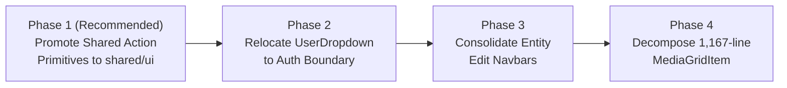

# Frontend Architecture Health Audit

**Date:** 2026-11-06  
**Auditor:** Antigravity AI Coding Assistant  
**Target:** OpenArt Frontend Application (`my-app/`)  
**Scope:** Read-Only, Evidence-Based Architecture Health Audit  
**Status:** Complete

---

## Executive Summary

Following the completion of the Design System Foundation, Shared UI Improvements, Gallery Layout Consolidation (`SharedGalleryGrid`), and Unified MediaView Architecture (Phases 1–3), this audit evaluates the structural health, dependency directions, and maintainability of the frontend codebase.

The primary finding is that the core presentation tier is in excellent health: `MediaView` and `SharedGalleryGrid` have successfully eliminated redundant rendering and layout code across the application. However, historical growth has left **structural layer inversions** where feature modules import components trapped in the `widgets/` layer, a monolithic 1,167-line component (`MediaGridItem`) that conflates Studio, Trash, and Folder lifecycles, and duplicate Navbar specializations.

This audit details the current state, catalogues concrete problems with exact `file:line` citations, evaluates root causes, and recommends **ONE high-ROI next implementation phase**: extracting shared action primitives (`ConfirmDeleteDialog` and `ActionBtn`) to `@/shared/ui/`, eliminating 7 cross-layer FSD boundary inversions with zero regression risk.

---

## 1. Current Architecture Map

The application follows an adapted **Feature-Sliced Design (FSD)** architecture with six primary layers:

```
┌─────────────────────────────────────────────────────────────┐
│ 1. App Layer (src/app/)                                     │
│    Next.js App Router: routes, layouts, dynamic parameters │
└──────────────────────────────┬──────────────────────────────┘
                               │
┌──────────────────────────────▼──────────────────────────────┐
│ 2. Widgets Layer (src/widgets/)                             │
│    Composite UI blocks: StudioLayout, Navbars, Popovers     │
└──────────────┬───────────────────────────────┬──────────────┘
               │                               │
┌──────────────▼──────────────┐ ┌──────────────▼──────────────┐
│ 3. Features Layer           │ │ 4. Cinema Studio Components │
│    (src/features/)          │ │    (src/components/cinema-  │
│    media, workflows, assets,│ │     studio/)                │
│    projects, prompt-bar, etc│ │    Legacy domain UI & cards │
└──────────────┬──────────────┘ └──────────────┬──────────────┘
               │                               │
┌──────────────▼───────────────────────────────▼──────────────┐
│ 5. Shared Layer (src/shared/)                               │
│    Canonical UI primitives, API client, utilities, tokens   │
└─────────────────────────────────────────────────────────────┘
```

### Architectural Responsibilities:
- **`app/`**: Next.js App Router entry points (`cinema-studio/[projectId]/`, `assets/`, `characters/`, `elements/`, `collection/`).
- **`widgets/`**: High-level page blocks composed of multiple features (e.g. `StudioNavbar`, `NavbarCore`, `StudioLayout`, `ImportMediaDialog`).
- **`features/`**: Domain business logic, React Query queries/mutations, Zustand stores, and domain-specific adapters (e.g. `media`, `workflows`, `assets`, `projects`, `prompt-bar`, `trash`).
- **`components/cinema-studio/`**: Historical domain components for Cinema Studio (character cards, element sidebars, reference galleries) acting as specialized feature UI.
- **`shared/`**: Domain-agnostic UI primitives (`Button`, `Dialog`, `DropdownMenu`, `ProcessingCard`, `FlowErrorTile`), API client, query key factories, and CSS design tokens.

---

## 2. Verified Architectural Strengths

1. **Unified Media Presentation Engine (`MediaView`)**:
   - Location: `src/features/media/ui/MediaView.jsx:1-163`
   - All media rendering (images, HTML5 videos, aspect ratio enforcement, loading indicators via `ProcessingCard`, and error states via `FlowErrorTile`) is now 100% centralized.
   - Callers across workflows (`WorkflowMediaGallery.jsx`), asset library (`LibraryMediaGridItem.jsx`), media picker (`MediaViewCard.jsx`), media viewer (`EditMediaView.jsx`), and character turnaround sheets (`CharacterSheetSection.jsx`) delegate directly to `MediaView`.
2. **Consolidated Gallery Layout Engine (`SharedGalleryGrid`)**:
   - Location: `src/features/media/ui/SharedGalleryGrid.jsx:1-125`
   - Row calculation, responsive spacing, constrained row heights, and layout virtualization are standardized using `react-photo-album/rows`.
3. **Canonical Design System & Automated Ratchet Enforcement**:
   - The design tokens in `my-app/docs/ui-system/design.md` and `globals.css` are enforced automatically via `npm run ui:check`.
   - The baseline ratchet currently shows zero regressions across all rules:
     - U1 (raw colors): 235 (down from 448 baseline)
     - U2 (arbitrary Tailwind values): 713 (down from 1258 baseline)
     - U5 (inline styles): 81 (down from 97 baseline)
     - U6 (dead radius classes): 0
     - U7 (positive shadow classes): 0
4. **Centralized Query Key Infrastructure**:
   - Location: `src/shared/api/queryKeys.js:1-50`
   - Strict hierarchical query keys (`auth`, `projects`, `workflows`, `assets`, `library`, `models`, `projectData`, `folders`, `trash`) prevent stale cache collisions and provide consistent mutation invalidation.
5. **High Test Coverage and Stability**:
   - Vitest suite executes 129 test files and 879 automated unit/integration tests with 100% pass rate in ~11.5s.

---

## 3. Concrete Problems Identified

### Problem A: FSD Layer Inversions — Shared Dialogs & Action Buttons Trapped in Widgets Layer
**Severity:** High  
**Rule Violated:** In Feature-Sliced Design, lower layers (`features/`, `components/`) must NEVER import from upper layers (`widgets/`).

1. **`ConfirmDeleteDialog` trapped in `widgets/`:**
   - Source: `src/widgets/dialogs/ConfirmDeleteDialog.jsx:19-29`
   - Description: The file header notes: *"Generic delete confirmation dialog. Use it anywhere you need a simple 'Are you sure?' delete flow."* It is a purely presentational wrapper over `@/shared/ui/dialog` and `@/shared/ui/button` with zero Studio or widget state.
   - Violating Callers:
     - `src/features/assets/ui/LibraryMediaGridItem.jsx:12`: `import { ConfirmDeleteDialog } from "@/widgets/dialogs/ConfirmDeleteDialog";`
     - `src/features/projects/ui/ProjectCard.jsx:9`: `import { ConfirmDeleteDialog } from "@/widgets/dialogs/ConfirmDeleteDialog";`
     - `src/features/workflows/ui/WorkflowMediaGallery.jsx:11`: `import { ConfirmDeleteDialog } from "@/widgets/dialogs/ConfirmDeleteDialog";`
     - `src/widgets/EditNavbar/EditNavbar.jsx:13`: `import { ConfirmDeleteDialog } from "@/widgets/dialogs/ConfirmDeleteDialog";`
     - `src/widgets/StudioLayout/GenerationsStudio/MediaGridItem/MediaGridItem.jsx:8`: `import { ConfirmDeleteDialog } from "@/widgets/dialogs/ConfirmDeleteDialog";`
     - `src/shared/ui/__tests__/dialog.test.jsx:9`: `import { ConfirmDeleteDialog } from "@/widgets/dialogs/ConfirmDeleteDialog";`
2. **`ActionBtn` trapped 4 directories deep in `widgets/`:**
   - Source: `src/widgets/StudioLayout/GenerationsStudio/MediaGridItem/ActionBtn.jsx:5-18`
   - Description: A 19-line generic round icon button wrapper (`<Button variant="ghost" className="size-7 p-0 rounded-full ...">`).
   - Violating Callers:
     - `src/features/assets/ui/LibraryMediaGridItem.jsx:13`: `import { ActionBtn } from "@/widgets/StudioLayout/GenerationsStudio/MediaGridItem/ActionBtn";`
     - `src/features/workflows/ui/WorkflowMediaGallery.jsx:6`: `import { ActionBtn } from "@/widgets/StudioLayout/GenerationsStudio/MediaGridItem/ActionBtn";`
     - `src/components/cinema-studio/common/ReferenceMediaGalleryGrid.jsx:7`: `import { ActionBtn } from "@/widgets/StudioLayout/GenerationsStudio/MediaGridItem/ActionBtn";`
3. **`UserDropdown` trapped in `widgets/StudioNavbar/ui/`:**
   - Source: `src/widgets/StudioNavbar/ui/UserDropdown.jsx:22-198`
   - Description: Contains global user authentication logic (`useAuthSession`), wallet balance (`useWalletBalance`), login modal trigger (`LoginDialog`), package selection modal trigger, and sign-out mutation.
   - Violating Callers:
     - `src/features/assets/ui/AssetDetailNavbar.jsx:9`: `import { UserDropdown } from "@/widgets/StudioNavbar/ui/UserDropdown";`
     - `src/features/assets/ui/AssetsNavbar.jsx:7`: `import { UserDropdown } from "@/widgets/StudioNavbar/ui/UserDropdown";`
     - `src/widgets/NavbarCore/NavbarCore.jsx:5`: `import { UserDropdown } from "@/widgets/StudioNavbar/ui/UserDropdown";`
     - `src/widgets/ProjectsNavbar/ProjectsNavbar.jsx:10`: `import { UserDropdown } from "@/widgets/StudioNavbar/ui/UserDropdown";`
4. **`ProjectError` Inverted Re-Export in `shared/ui/`:**
   - Source: `src/shared/ui/ProjectError.jsx:5`
   - Description: `src/shared/ui/ProjectError.jsx` imports from `@/features/projects/ui/ProjectError`. In FSD, `shared/` can never import from `features/`.

---

### Problem B: Monolithic 1,167-Line `MediaGridItem` Conflating Multiple Domain Lifecycles
**Severity:** High  
**Rule Violated:** Single Responsibility Principle & Clean Code.

- Source: `src/widgets/StudioLayout/GenerationsStudio/MediaGridItem/MediaGridItem.jsx:1-1167`
- Breakdown of Conflated Concerns:
  - Lines 10-11: Imports Studio generation actions (`useWorkflowActions`, `useUpdateWorkflow`).
  - Lines 18, 67-91: Imports Trash lifecycle mutations (`useRestoreWorkflow`, `getTrashMenuItems`).
  - Line 20: Imports Folder management (`useUpdateFolder`, `useDeleteFolder`, `useFolderMove`, `useDownloadCollection`).
  - Line 12, 78: Imports pointer drag lifecycle (`useStudioItemDrag`).
  - Lines 94-100: Maintains 6 separate pieces of local UI state (`isDropdownOpen`, `isDeleteConfirmOpen`, `isRenaming`, `cardRect`, `measuredWidth`).
- Callers:
  - `src/features/trash/ui/TrashMediaGridItem.jsx:4` & `TrashView.jsx:11` import this monolithic widget just to render deleted items with `isTrash={true}`.
  - `src/app/cinema-studio/[projectId]/assets/page.js:18`, `characters/page.js:14`, `collection/[collectionId]/page.jsx:20`, and `elements/page.js:16` import it directly.

---

### Problem C: Duplicate Specializations in Entity Edit Navbars
**Severity:** Medium  
**Rule Violated:** DRY (Don't Repeat Yourself) & Component Composition.

- Sources:
  - `src/widgets/CharacterEditNavbar/CharacterEditNavbar.jsx:19-111` (111 lines)
  - `src/widgets/ElementEditNavbar/ElementEditNavbar.jsx:19-109` (109 lines)
- Evidence of Duplication:
  - Both components take virtually identical props: `onDelete...`, `onDone`, `onUpload`, `onOpenAssets`, `isLiked`, `onToggleLike`, `actions`, `children`, `importMenuOpen`, `onImportMenuOpenChange`, `showUserDropdown`.
  - Both render `EntityEditNavbar` wrapped with identical import dropdowns (Upload vs Assets), identical favorite toggle buttons, and identical action sequences.
  - The only variation is the string `"character"` versus `"element"`.

---

### Problem D: Non-Reactive Query Cache Traversal in `AssetDetailNavbar`
**Severity:** Medium  
**Rule Violated:** Data-Fetching & State Ownership conventions.

- Source: `src/features/assets/ui/AssetDetailNavbar.jsx:13-31`
- Evidence:
  ```javascript
  // AssetDetailNavbar.jsx:13-31
  const queryClient = useQueryClient();
  const displayName = useMemo(() => {
    const detailEntry = queryClient.getQueryData(queryKeys.library.detail(workflowId));
    if (detailEntry?.workflow?.display_name) return detailEntry.workflow.display_name;

    const queries = queryClient.getQueriesData({ queryKey: queryKeys.library.all() });
    for (const [, queryData] of queries) {
      for (const page of queryData?.pages || []) {
        const match = (page?.data || []).find((entry) => entry?.workflow?.id === workflowId);
        if (match?.workflow?.display_name) return match.workflow.display_name;
      }
    }
    return "Asset Detail";
  }, [queryClient, workflowId]);
  ```
- Anti-pattern: Reading cache synchronously via `queryClient.getQueriesData` inside a `useMemo([queryClient, workflowId])` is not reactive. If the data is being fetched in the background, `useMemo` will not recompute when data arrives because the `queryClient` reference does not change.
- Ready Solution Already Available: `useLibraryWorkflowDetail` is already defined in `src/features/workflows/api/queries/useLibraryWorkflowDetail.js:3` and should be used reactively.

---

### Problem E: Redundant Facade in `features/studio`
**Severity:** Low  
**Rule Violated:** YAGNI & Codebase Simplicity.

- Sources:
  - `src/features/studio/index.js:1-11`
  - `src/features/studio/usePromptStore.js:1`
- Evidence:
  - Lines 1-9 of `features/studio/index.js` simply re-export hooks and services from `features/prompt-bar/` (`usePromptStore`, `useCharacterStore`, `useElementStore`, `entityService`, `tagsService`).
  - Only a single production file (`src/widgets/StudioLayout/GenerationsStudio/MediaGridItem/MediaGridItem.jsx:12`) imports from `@/features/studio`.

---

## 4. Impact and Severity Matrix

| Problem | Severity | Maintainability Risk | Blast Radius | Refactoring Complexity |
|---|---|---|---|---|
| **A. FSD Layer Inversions (`ConfirmDeleteDialog`, `ActionBtn`, `UserDropdown`)** | **High** | High (creates circular dependency hazards and architectural erosion) | Low to Medium | **Low (pure relocation & import updates)** |
| **B. Monolithic `MediaGridItem` (1,167 lines)** | **High** | High (high bug surface when touching trash, folders, or studio) | High | High (requires multi-step extraction) |
| **C. Entity Edit Navbar Duplication** | **Medium** | Medium (dual-maintenance when changing navigation actions) | Low | Low |
| **D. Non-Reactive Cache Read in `AssetDetailNavbar`** | **Medium** | Medium (silent UI stale/fallback display bug) | Very Low | Low |
| **E. `features/studio` Facade** | **Low** | Low (slight navigation confusion for developers/agents) | Very Low | Low |

---

## 5. Root Cause Analysis

1. **Evolutionary Boundary Drift**:
   - `ConfirmDeleteDialog` and `ActionBtn` were initially built for the Studio Media Grid (`widgets/StudioLayout/`). Later, when `features/assets` and `features/workflows` needed deletion confirmation and overlay action buttons, developers took the shortest path and imported the existing widget components rather than promoting them to shared UI primitives.
2. **Navbars Built Per-Page Rather than by Capability**:
   - Instead of treating `UserDropdown` as an authentication feature component (`@/features/auth/ui/UserDropdown`), it was placed inside `widgets/StudioNavbar/ui/`. Every subsequent navbar (`NavbarCore`, `ProjectsNavbar`, `AssetsNavbar`) was forced to cross-import from `StudioNavbar`.
3. **Kitchen-Sink Component Expansion**:
   - `MediaGridItem.jsx` grew organically by accumulating new features (first generations, then folders, then trash restoration, then drag-and-drop auto-scroll) without splitting along domain lifecycle boundaries.

---

## 6. Recommended Improvements Ranked by ROI

```
Value vs. Risk Matrix:

HIGH VALUE  ▲ [Phase 1: Shared Action]      [Phase 4: MediaGridItem]
            │   Primitives Extraction         Decomposition
            │
            │ [Phase 2: UserDropdown]
            │   Auth Boundary Move
            │
            │ [Phase 3: Navbar Core]
LOW VALUE   │   Consolidation
            └──────────────────────────────────────────────►
             LOW RISK                                HIGH RISK
```

1. **Rank 1 (Highest ROI): Extract Shared Action Primitives to `@/shared/ui/`**
   - *Action:* Move `ConfirmDeleteDialog` to `src/shared/ui/ConfirmDeleteDialog.jsx` and promote `ActionBtn` to `src/shared/ui/action-button.jsx` (or variant in `button.jsx`).
   - *Value:* Immediately eliminates 7 cross-layer FSD boundary inversions across `features/assets`, `features/projects`, `features/workflows`, and `components/cinema-studio`.
   - *Risk:* Extremely Low. Zero business logic changes; 100% backward compatibility via shim re-exports.
2. **Rank 2: Extract `UserDropdown` to Auth Domain**
   - *Action:* Relocate `UserDropdown` from `src/widgets/StudioNavbar/ui/` to `src/features/auth/ui/UserDropdown.jsx` (or a dedicated widget `src/widgets/UserDropdown/`).
   - *Value:* Resolves cross-widget coupling between `NavbarCore`, `ProjectsNavbar`, and `AssetsNavbar`.
   - *Risk:* Low. Pure UI component relocation.
3. **Rank 3: Fix `AssetDetailNavbar` & Clean Up `features/studio` Facade**
   - *Action:* Replace `queryClient.getQueriesData` traversal with `useLibraryWorkflowDetail` hook; inline or delete unused re-exports in `features/studio`.
   - *Value:* Fixes potential title sync bugs in asset detail view; cleans up dead aliases.
   - *Risk:* Very Low.
4. **Rank 4: Deduplicate `CharacterEditNavbar` and `ElementEditNavbar`**
   - *Action:* Collapse into parameterized `<EntityEditNavbar>` usage or single unified component.
   - *Value:* Removes ~110 lines of duplicated JSX and handler boilerplate.
   - *Risk:* Low.
5. **Rank 5: Decompose `MediaGridItem.jsx` into Specialized Adapters**
   - *Action:* Split into `StudioMediaCard`, `TrashMediaCard`, and `FolderGridCard`.
   - *Value:* Drastically improves maintainability of the primary grid item.
   - *Risk:* High. Extensive event handling, drag interactions, and context menu behaviors require meticulous test coverage.

---

## 7. Explicit Non-Goals (What Should NOT Be Changed)

To avoid regressions and churn, the following areas must remain untouched:
- **DO NOT touch `src/features/media/ui/MediaView.jsx`**: Completed canonical presentation engine.
- **DO NOT touch `src/features/media/ui/SharedGalleryGrid.jsx`**: Completed canonical layout engine.
- **DO NOT alter `src/shared/api/queryKeys.js`**: Stable, well-tested cache contract.
- **DO NOT perform mass rewrites of `src/components/cinema-studio/`**: While outside FSD, moving them en masse without a specific domain requirement introduces high risk with zero user benefit.
- **DO NOT touch backend contracts or API schemas**: Backend tenant isolation and ownership contracts are working as intended.

---

## 8. Proposed Implementation Roadmap



- **Phase 1: Shared Action Primitives & Dialog Extraction**
  - Promote `ConfirmDeleteDialog` $\to$ `src/shared/ui/ConfirmDeleteDialog.jsx`
  - Promote `ActionBtn` $\to$ `src/shared/ui/action-button.jsx`
  - Fix inverted re-export in `src/shared/ui/ProjectError.jsx`
- **Phase 2: Auth Navigation Boundary Extraction**
  - Relocate `UserDropdown` $\to$ `src/widgets/UserDropdown/` or `src/features/auth/ui/`
  - Update imports in `StudioNavbar`, `NavbarCore`, `ProjectsNavbar`, and `AssetsNavbar`
- **Phase 3: Navbar Core Consolidation & Detail Hook Fix**
  - Deduplicate `CharacterEditNavbar` and `ElementEditNavbar`
  - Adopt reactive `useLibraryWorkflowDetail` in `AssetDetailNavbar`
- **Phase 4: `MediaGridItem` Lifecycle Decomposition**
  - Extract `TrashMediaGridItem` adapter (separate from Studio card)
  - Extract `FolderGridItem` adapter
  - Keep `StudioMediaGridItem` focused exclusively on studio generations

---

## 9. Verification Strategy

Each proposed phase must satisfy the following three-gate verification before completion:

1. **Automated Test Suite**:
   ```bash
   cd my-app && npm test
   ```
   Must pass all 129 test files and 879 unit/integration tests with 0 failures.
2. **Design System Ratchet Check**:
   ```bash
   cd my-app && npm run ui:check
   ```
   Must report 0 new violations across rules U1–U7.
3. **Production Build Compilation**:
   ```bash
   cd my-app && npm run build
   ```
   Must compile Next.js production build cleanly with zero type or bundling errors.

---

## 10. ONE Recommended Next Implementation Phase

### Recommended Phase: Phase 1 — Extraction of Shared Action Primitives & Dialogs to `@/shared/ui/`

This phase addresses the highest concentration of active architectural layer inversions in the application with near-zero risk.

#### Exact Scope of Changes:
1. **Move `ConfirmDeleteDialog` to `shared/ui/`**:
   - Create `src/shared/ui/ConfirmDeleteDialog.jsx` (relocated from `widgets/dialogs/ConfirmDeleteDialog.jsx`).
   - Retain a compatibility shim at `src/widgets/dialogs/ConfirmDeleteDialog.jsx` re-exporting from `@/shared/ui/ConfirmDeleteDialog`.
   - Update callers in `src/features/assets/ui/LibraryMediaGridItem.jsx:12`, `src/features/projects/ui/ProjectCard.jsx:9`, and `src/features/workflows/ui/WorkflowMediaGallery.jsx:11` to import directly from `@/shared/ui/ConfirmDeleteDialog`.
2. **Promote `ActionBtn` to Canonical Shared Primitive**:
   - Create `src/shared/ui/action-button.jsx` exporting `ActionBtn` with canonical styling aligned with `design.md`.
   - Retain a compatibility shim at `src/widgets/StudioLayout/GenerationsStudio/MediaGridItem/ActionBtn.jsx`.
   - Update callers in `src/features/assets/ui/LibraryMediaGridItem.jsx:13`, `src/features/workflows/ui/WorkflowMediaGallery.jsx:6`, and `src/components/cinema-studio/common/ReferenceMediaGalleryGrid.jsx:7`.
3. **Eliminate Upward Re-Export in `src/shared/ui/ProjectError.jsx`**:
   - Update `src/app/cinema-studio/error.jsx`, `not-found.jsx`, and `layout.js` to import directly from `@/features/projects/ui/ProjectError`.
   - Safely remove the upward-pointing shim `src/shared/ui/ProjectError.jsx`.

#### Measurable Acceptance Criteria:
- [ ] Exactly 0 imports from `@/widgets/dialogs/ConfirmDeleteDialog` inside `src/features/`.
- [ ] Exactly 0 imports from `@/widgets/StudioLayout/.../ActionBtn` inside `src/features/` or `src/components/`.
- [ ] Exactly 0 imports from `@/features/projects` inside `src/shared/ui/`.
- [ ] Vitest test suite passes with 100% success rate (`129 passed`).
- [ ] `npm run ui:check` passes with 0 new violations.
- [ ] `npm run build` succeeds cleanly.
