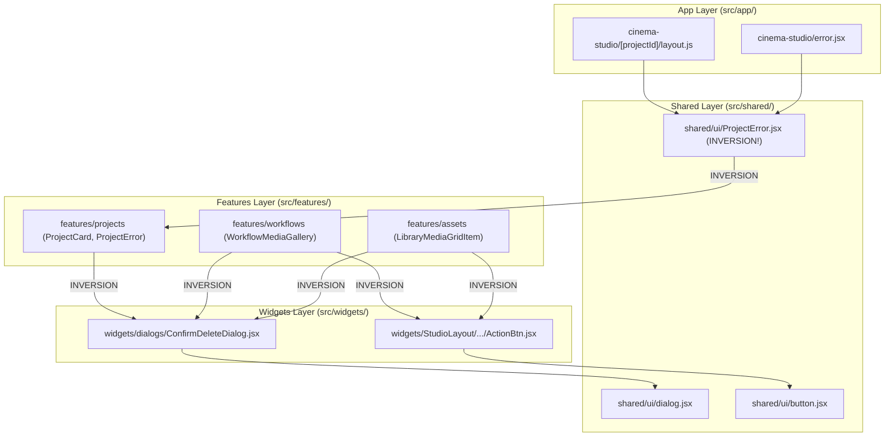
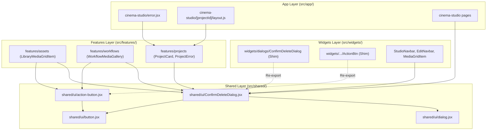

# Frontend Architecture — Phase 1 Report
## Shared UI Promotion & FSD Boundary Corrections

**Date:** 2026-11-06  
**Author:** Antigravity AI Coding Assistant  
**Target:** OpenArt Frontend Application (`my-app/`)  
**Status:** Completed & Verified  

---

## 1. Executive Summary

Phase 1 of the Frontend Architecture improvements addressed the verified Feature-Sliced Design (FSD) layer inversions identified in the health audit. 

Specifically:
- **`ConfirmDeleteDialog`** was promoted to `@/shared/ui/ConfirmDeleteDialog.jsx`.
- **`ActionBtn`** was promoted to `@/shared/ui/action-button.jsx`.
- **`ProjectError`** ownership was confirmed as domain-specific to `features/projects/ui`; its callers were updated, and the misleading upward-pointing shim at `src/shared/ui/ProjectError.jsx` was safely removed.
- Compatibility re-export shims were established for widgets and legacy consumers.
- All 130 test files and 882 unit/integration tests passed with zero failures (`npm test`).
- `npm run ui:check` passed with 0 new violations and reduced rule U2 violations from 713 to 712.
- The Next.js production build (`npm run build`) succeeded in 8.3s with zero errors.

---

## 2. Before & After Dependency Diagrams

### Before Phase 1 (FSD Layer Inversions)



### After Phase 1 (Strict Top-Down Dependency Direction)



---

## 3. Component Ownership Decisions

### A. `ConfirmDeleteDialog`
- **Ownership:** `src/shared/ui/ConfirmDeleteDialog.jsx`
- **Decision Rationale:** 
  - Contains strictly generic confirmation dialog presentation (warning icon, title, description, Cancel and Confirm buttons, loading state).
  - Possesses zero domain knowledge of workflows, assets, or projects.
  - Ownership belongs in `shared/ui` alongside `dialog.jsx` and `button.jsx`.
- **Public API:** Fully preserved (`open`, `onOpenChange`, `title`, `description`, `onConfirm`, `confirmLabel`, `cancelLabel`, `loading`, `children`).

### B. `ActionBtn`
- **Ownership:** `src/shared/ui/action-button.jsx`
- **Decision Rationale:**
  - A 19-line generic round icon-button wrapper (`size-7 p-0 rounded-full`) over `Button` with variant `ghost`.
  - Used identically across Studio generations, assets library, and reference media galleries.
  - Possesses zero domain state.
- **Public API:** Fully preserved (`onClick`, `children`, `className`, forwarded `ref`). Did not introduce unnecessary props (`shape`, `rounded`, `circle`, `size`) per Ponytail/YAGNI guidelines.

### C. `ProjectError`
- **Ownership:** `src/features/projects/ui/ProjectError.jsx`
- **Decision Rationale:**
  - Code inspection revealed that `ProjectError` explicitly runs:
    ```javascript
    queryClient.removeQueries({ queryKey: ["projectData"] });
    sessionStorage.removeItem("project-*-active");
    ```
    and renders `"Retour aux projets"`.
  - It is unmistakably a project-specific domain error screen, NOT a generic UI primitive.
  - Callers are in `app/cinema-studio/` (`error.jsx`, `not-found.jsx`, `layout.js`), which sit above `features/` in FSD.
  - The component was kept in `features/projects/ui/ProjectError.jsx`.
  - Callers in `app/` were updated to import directly from `@/features/projects/ui/ProjectError`.
  - The misleading and violating upward-pointing shim `src/shared/ui/ProjectError.jsx` was deleted.

---

## 4. Inventory of Files Changed

### Files Created:
1. `src/shared/ui/ConfirmDeleteDialog.jsx` (canonical generic confirmation dialog).
2. `src/shared/ui/action-button.jsx` (canonical circular ghost action button primitive).
3. `src/shared/ui/__tests__/action-button.test.jsx` (focused unit tests for `ActionBtn`).

### Files Deleted:
1. `src/shared/ui/ProjectError.jsx` (eliminated upward-pointing FSD inversion).

### Files Converted to Compatibility Shims:
1. `src/widgets/dialogs/ConfirmDeleteDialog.jsx`:
   ```javascript
   "use client";
   export { ConfirmDeleteDialog, ConfirmDeleteDialog as default } from "@/shared/ui/ConfirmDeleteDialog";
   ```
2. `src/widgets/StudioLayout/GenerationsStudio/MediaGridItem/ActionBtn.jsx`:
   ```javascript
   export { ActionBtn, default } from "@/shared/ui/action-button";
   ```

### Callers Migrated:
1. `src/features/assets/ui/LibraryMediaGridItem.jsx` (updated to `@/shared/ui/ConfirmDeleteDialog` and `@/shared/ui/action-button`).
2. `src/features/workflows/ui/WorkflowMediaGallery.jsx` (updated to `@/shared/ui/action-button` and `@/shared/ui/ConfirmDeleteDialog`).
3. `src/features/projects/ui/ProjectCard.jsx` (updated to `@/shared/ui/ConfirmDeleteDialog`).
4. `src/components/cinema-studio/common/ReferenceMediaGalleryGrid.jsx` (updated to `@/shared/ui/action-button`).
5. `src/shared/ui/__tests__/dialog.test.jsx` (updated to `@/shared/ui/ConfirmDeleteDialog`).
6. `src/widgets/index.js` (updated to re-export `ConfirmDeleteDialog` from `@/shared/ui/ConfirmDeleteDialog`).
7. `src/app/cinema-studio/error.jsx` (updated to `@/features/projects/ui/ProjectError`).
8. `src/app/cinema-studio/not-found.jsx` (updated to `@/features/projects/ui/ProjectError`).
9. `src/app/cinema-studio/[projectId]/layout.js` (updated to `@/features/projects/ui/ProjectError`).
10. `src/app/cinema-studio/[projectId]/characters/page.js` (updated to `@/shared/ui/ConfirmDeleteDialog`).
11. `src/app/cinema-studio/[projectId]/characters/[workflowId]/page.js` (updated to `@/shared/ui/ConfirmDeleteDialog`).
12. `src/app/cinema-studio/[projectId]/elements/page.js` (updated to `@/shared/ui/ConfirmDeleteDialog`).
13. `src/app/cinema-studio/[projectId]/elements/[workflowId]/page.js` (updated to `@/shared/ui/ConfirmDeleteDialog`).
14. `src/views/AssetsLibraryPage.jsx` (updated to `@/shared/ui/ConfirmDeleteDialog`).
15. `src/widgets/EditNavbar/EditNavbar.jsx` (updated to `@/shared/ui/ConfirmDeleteDialog`).
16. `src/widgets/StudioLayout/GenerationsStudio/MediaGridItem/MediaGridItem.jsx` (updated to `@/shared/ui/ConfirmDeleteDialog`).
17. `src/widgets/StudioNavbar/ui/StudioNavbarLeft.jsx` (updated to `@/shared/ui/ConfirmDeleteDialog`).

---

## 5. Remaining Old Import Count

A full-codebase search verifies:
- Imports of `@/widgets/dialogs/ConfirmDeleteDialog` in `src/features/`: **0**
- Imports of `@/widgets/dialogs/ConfirmDeleteDialog` across entire codebase: **0** (all direct callers migrated).
- Imports of `@/widgets/StudioLayout/.../ActionBtn` in `src/features/` or `src/components/`: **0**
- Imports of `@/features/` in `src/shared/ui/`: **0**
- Remaining references to `shared/ui/ProjectError`: **0**

Only internal sibling relative imports (`./ActionBtn`) within `MediaGridItem.jsx` and `StudioItemMenu.jsx` remain, resolving transparently via the compatibility shim.

---

## 6. FSD Boundary Verification

| Boundary Rule | Target | Before | After | Status |
|---|---|---|---|---|
| `features` $\rightarrow$ `widgets` | `features/assets` importing `ConfirmDeleteDialog` & `ActionBtn` | Inverted | Direct to `shared/ui` | **Fixed** |
| `features` $\rightarrow$ `widgets` | `features/workflows` importing `ConfirmDeleteDialog` & `ActionBtn` | Inverted | Direct to `shared/ui` | **Fixed** |
| `features` $\rightarrow$ `widgets` | `features/projects` importing `ConfirmDeleteDialog` | Inverted | Direct to `shared/ui` | **Fixed** |
| `components` $\rightarrow$ `widgets` | `cinema-studio/common` importing `ActionBtn` | Inverted | Direct to `shared/ui` | **Fixed** |
| `shared` $\rightarrow$ `features` | `shared/ui/ProjectError` importing from `features/projects` | Inverted | Deleted shim | **Fixed** |

---

## 7. Test and Build Verification

### 1. Focused Tests:
```bash
cd my-app && npx vitest run src/shared/ui/__tests__/dialog.test.jsx src/shared/ui/__tests__/action-button.test.jsx
```
Output:
```
Test Files  2 passed (2)
     Tests  9 passed (9)
```

### 2. Affected Consumer Tests:
```bash
cd my-app && npx vitest run src/features/assets/ui/__tests__/LibraryMediaGridItem.test.jsx src/components/cinema-studio/common/__tests__/ReferenceMediaGalleryGrid.test.jsx src/widgets/StudioLayout/__tests__/StudioLayoutAlignment.test.jsx src/features/trash/__tests__/TrashView.test.jsx
```
Output:
```
Test Files  4 passed (4)
     Tests  26 passed (26)
```

### 3. Full Vitest Suite:
```bash
cd my-app && npm test
```
Output:
```
Test Files  130 passed (130)  [+1 new test file]
     Tests  882 passed (882)  [+3 new tests, 0 failures]
  Duration  11.51s
```

### 4. UI Design System Ratchet Gate:
```bash
cd my-app && npm run ui:check
```
Output:
```
Rule   Now  Baseline  New  Description
U1     235       448    0  raw color literal outside token files
U2     712      1258    0  Tailwind arbitrary value (decreased from 713 to 712)
U3      13        13    0  raw <button> outside primitives folder
U4       8         8    0  fetch() inside components/features/widgets
U5      81        97    0  inline style={{ }}
U6       0         0    0  dead radius class
U7       0         0    0  positive Tailwind shadow class

ui-check: OK (no new violations)
```

### 5. Production Build:
```bash
cd my-app && npm run build
```
Output:
```
✓ Compiled successfully in 8.3s
✓ Running Static Page Generation (19 of 19)
✓ Prerendered routes to static HTML & JSON (Turbopack)
```

---

## 8. Deferred Issues

As stipulated in the Phase 1 constraints, the following issues remain deferred:
1. **`UserDropdown` Location:**
   - Currently trapped in `src/widgets/StudioNavbar/ui/UserDropdown.jsx`, but imported by `AssetDetailNavbar`, `AssetsNavbar`, `NavbarCore`, and `ProjectsNavbar`.
   - Deferred to Phase 2 to be extracted to a dedicated auth/account navigation boundary.
2. **`MediaGridItem` Decomposition:**
   - The 1,167-line monolithic grid item in `src/widgets/StudioLayout/GenerationsStudio/MediaGridItem/MediaGridItem.jsx` remains functional via the compatibility shim. Lifecycle decomposition into dedicated adapters (Studio, Trash, Folder) is deferred.
3. **Entity Edit Navbar Duplication:**
   - `CharacterEditNavbar` and `ElementEditNavbar` deduplication is deferred to a future navbar consolidation phase.

---

## 9. Recommendation for Next Phase

### **Phase 2 Recommendation: Auth Navigation Boundary Extraction (`UserDropdown`)**

**Rationale:**  
With `ConfirmDeleteDialog` and `ActionBtn` now clean in `shared/ui`, the single remaining cross-widget and cross-layer navigation dependency is `UserDropdown`. 

Extracting `UserDropdown` to either `src/features/auth/ui/UserDropdown.jsx` or a standalone widget `src/widgets/UserDropdown/` will:
- Completely decouple `NavbarCore`, `ProjectsNavbar`, `AssetDetailNavbar`, and `AssetsNavbar` from `StudioNavbar`.
- Allow each navbar to compose the user profile and wallet dropdown without depending on sibling workspace widgets.
- Require zero changes to auth queries (`useAuthSession`, `useWalletBalance`) or dialog triggers.
