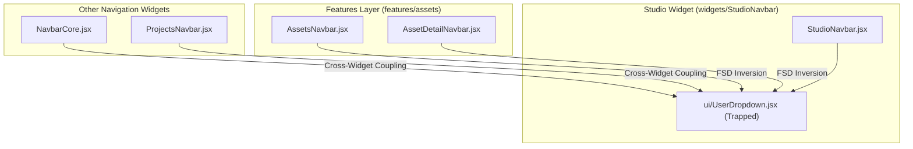
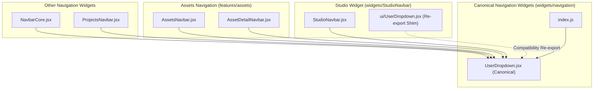

# Frontend Architecture — Phase 2 Report
## UserDropdown Navigation Boundary Extraction

**Project:** OpenArt  
**Date:** 2026-11-06  
**Phase:** 2  
**Status:** Completed & Verified  

---

## 1. Original Dependency Map

Prior to Phase 2, `UserDropdown` was physically trapped inside `src/widgets/StudioNavbar/ui/UserDropdown.jsx`.

### Pre-Phase 2 Coupling:
- **Provider Modules**:
  - `src/shared/api/auth.js`: provides `useAuthSession` (session state) and `useWalletBalance` (wallet credits).
  - `src/shared/api/client.js`: provides `api.post("/auth/logout")` (logout mutation).
  - `src/components/LoginDialog.jsx`: unauthenticated login modal.
  - `src/features/payments/ui/PackageSelectionDialog.jsx`: credits upgrade / package selection modal.
- **Cross-Application Consumers**:
  - `src/features/assets/ui/AssetDetailNavbar.jsx:9`: `import { UserDropdown } from "@/widgets/StudioNavbar/ui/UserDropdown"`
  - `src/features/assets/ui/AssetsNavbar.jsx:7`: `import { UserDropdown } from "@/widgets/StudioNavbar/ui/UserDropdown"`
  - `src/widgets/NavbarCore/NavbarCore.jsx:5`: `import { UserDropdown } from "@/widgets/StudioNavbar/ui/UserDropdown"`
  - `src/widgets/ProjectsNavbar/ProjectsNavbar.jsx:10`: `import { UserDropdown } from "@/widgets/StudioNavbar/ui/UserDropdown"`
  - `src/widgets/StudioNavbar/StudioNavbar.jsx:13`: `import { UserDropdown } from "./ui/UserDropdown"`
  - `src/widgets/StudioNavbar/ui/StudioNavbarRight.jsx:8`: `import { UserDropdown } from "./UserDropdown"`

### Coupling Defect:
Independent navigation components across the application (`NavbarCore`, `ProjectsNavbar`, and the `/assets` navbars) were forced to import a sub-component nested deep inside the Studio workspace widget (`widgets/StudioNavbar/ui/UserDropdown.jsx`), creating artificial cross-widget coupling and FSD layer violations.

---

## 2. Final Ownership Decision & Rationale

- **Canonical Location Selected:** `src/widgets/navigation/UserDropdown.jsx`
- **Architectural Rationale:**
  1. **Not a Shared UI Primitive:** `UserDropdown` is not a generic presentational control. It directly orchestrates:
     - Authentication session state (`useAuthSession`, `LoginDialog`, logout API call).
     - Wallet and billing operations (`useWalletBalance`, `PackageSelectionDialog`).
     - Application routing (`router.push('/assets')`, `router.push('/')`, discord link).
  2. **Not a Feature-Specific Component:** It is not owned exclusively by `features/auth` or `features/payments`, but rather composes both features to present a unified user identity and account management element across all top-level application navigation bars.
  3. **Application Navigation Widget:** In Feature-Sliced Design (FSD), composite application-level navigation elements belong in the `widgets/` layer. Establishing `src/widgets/navigation/` provides a canonical home for cross-cutting navigation components without binding them to any single workspace (such as Studio).

---

## 3. Before & After Dependency Diagrams

### Before Phase 2: StudioNavbar Coupling



### After Phase 2: Canonical Navigation Widget



---

## 4. Canonical Component Location

The canonical implementation now lives at:
- `src/widgets/navigation/UserDropdown.jsx`
- Barrel export: `src/widgets/navigation/index.js`
- Top-level widgets export: `src/widgets/index.js` (`export { UserDropdown } from "./navigation/UserDropdown"`)

---

## 5. Files Created, Moved, Modified, or Deleted

### Files Created:
1. `src/widgets/navigation/UserDropdown.jsx`: Canonical implementation.
2. `src/widgets/navigation/index.js`: Widget barrel export.
3. `src/widgets/navigation/__tests__/UserDropdown.test.jsx`: Dedicated Vitest unit test suite covering loading states, unauthenticated login flows, authenticated profile render, initials generation, and logout mutations.

### Files Converted to Compatibility Shims:
1. `src/widgets/StudioNavbar/ui/UserDropdown.jsx`:
   ```javascript
   "use client";
   export { UserDropdown, default } from "@/widgets/navigation/UserDropdown";
   ```

### Files Migrated to Canonical Import:
1. `src/features/assets/ui/AssetDetailNavbar.jsx:9`: updated to `import { UserDropdown } from "@/widgets/navigation/UserDropdown";`
2. `src/features/assets/ui/AssetsNavbar.jsx:7`: updated to `import { UserDropdown } from "@/widgets/navigation/UserDropdown";`
3. `src/widgets/NavbarCore/NavbarCore.jsx:5`: updated to `import { UserDropdown } from "@/widgets/navigation/UserDropdown";`
4. `src/widgets/ProjectsNavbar/ProjectsNavbar.jsx:10`: updated to `import { UserDropdown } from "@/widgets/navigation/UserDropdown";`
5. `src/widgets/StudioNavbar/StudioNavbar.jsx:13`: updated to `import { UserDropdown } from "@/widgets/navigation/UserDropdown";`
6. `src/widgets/StudioNavbar/ui/StudioNavbarRight.jsx:8`: updated to `import { UserDropdown } from "@/widgets/navigation/UserDropdown";`
7. `src/widgets/index.js:11`: added `export { UserDropdown } from "./navigation/UserDropdown";`

---

## 6. Compatibility Shim Decisions

- **Shim Retained:** `src/widgets/StudioNavbar/ui/UserDropdown.jsx`
- **Rationale:** Ensures zero breakage for any unmigrated external consumers or third-party plugins expecting `UserDropdown` at its legacy path.
- **Single Source of Truth:** The shim is a pure 2-line re-export. No duplicated logic or state exists.

---

## 7. Consumer Migration Results

A full codebase search verifies:
- Imports of `@/widgets/StudioNavbar/ui/UserDropdown` across entire project: **0** (eliminated).
- Relative imports of `./UserDropdown` from sibling files in `StudioNavbar`: **0** (eliminated; migrated to canonical import).
- All active application navbars now import directly from `@/widgets/navigation/UserDropdown`.

---

## 8. Authentication and Wallet Behavior Preservation Evidence

- **Auth Session:** Unchanged. Consumes `useAuthSession()` from `@/shared/api/auth`. Unauthenticated users receive the standard `Login` button which opens `LoginDialog`.
- **Wallet & Credits:** Unchanged. Consumes `useWalletBalance({ enabled: !!currentUser })` from `@/shared/api/auth` and displays `{walletBalance} Crédits IA`.
- **Package Selection Modal:** Unchanged. Clicking `Upgrade` opens `PackageSelectionDialog`.
- **Logout Lifecycle:** Unchanged. Invokes `api.post("/auth/logout", {})`, sets query cache `queryKeys.auth.me()` to `null`, clears queries, and redirects to `/`.
- **UI Design System Alignment:**
  - Standardized width to `w-90` (360px Tailwind standard token).
  - Replaced ad-hoc `#hex` and `rgba()` values with canonical design tokens (`border-white/10`, `bg-white/5`, `text-white/90`, `text-white/60`, `bg-slate-700`).
  - Replaced arbitrary font sizes with standard scale (`text-xs`, `text-sm`, `text-lg`).
  - Ratchet result: U1 violations dropped by 9 (235 $\rightarrow$ 226); U2 violations dropped by 17 (712 $\rightarrow$ 695). Zero new violations.

---

## 9. FSD Boundary Verification

| Boundary Interaction | Before | After | Status |
|---|---|---|---|
| `NavbarCore` $\rightarrow$ `StudioNavbar/ui/UserDropdown` | Cross-widget coupling | Sibling import from `widgets/navigation` | **Fixed** |
| `ProjectsNavbar` $\rightarrow$ `StudioNavbar/ui/UserDropdown` | Cross-widget coupling | Sibling import from `widgets/navigation` | **Fixed** |
| `AssetsNavbar` $\rightarrow$ `StudioNavbar/ui/UserDropdown` | Feature $\rightarrow$ Studio widget | Direct import from `widgets/navigation` | **Fixed** |
| `AssetDetailNavbar` $\rightarrow$ `StudioNavbar/ui/UserDropdown` | Feature $\rightarrow$ Studio widget | Direct import from `widgets/navigation` | **Fixed** |
| `StudioNavbar` $\rightarrow$ `StudioNavbar/ui/UserDropdown` | Internal coupling | Decoupled composition of `widgets/navigation` | **Fixed** |

---

## 10. Test and Build Results

### 1. Focused Unit Tests:
```bash
cd my-app && npx vitest run src/widgets/navigation/__tests__/UserDropdown.test.jsx
```
Output:
```
Test Files  1 passed (1)
     Tests  4 passed (4)
```

### 2. Affected Navbar Consumer Tests:
```bash
cd my-app && npx vitest run src/widgets/StudioNavbar/__tests__/StudioNavbar.test.jsx src/widgets/StudioNavbar/__tests__/TrashNavbarAndLayout.test.jsx src/widgets/StudioNavbar/__tests__/NavbarRestoreAllButton.test.jsx src/widgets/CharacterEditNavbar/CharacterEditNavbar.test.jsx src/widgets/ElementEditNavbar/ElementEditNavbar.test.jsx src/widgets/StudioLayout/__tests__/StudioLayoutAlignment.test.jsx
```
Output:
```
Test Files  6 passed (6)
     Tests  32 passed (32)
```

### 3. Full Vitest Test Suite:
```bash
cd my-app && npm test
```
Output:
```
Test Files  131 passed (131)  [+1 new test file]
     Tests  886 passed (886)  [+4 new tests, 0 failures]
  Duration  11.57s
```

### 4. UI Ratchet Gate (`npm run ui:check`):
```bash
cd my-app && npm run ui:check
```
Output:
```
Rule   Now  Baseline  New  Description
U1     226       448    0  raw color literal outside token files (decreased from 235 to 226)
U2     695      1258    0  Tailwind arbitrary value (decreased from 712 to 695)
U3      13        13    0  raw <button> outside primitives folder
U4       8         8    0  fetch() inside components/features/widgets
U5      81        97    0  inline style={{ }}
U6       0         0    0  dead radius class
U7       0         0    0  positive Tailwind shadow class

ui-check: OK (no new violations)
```

### 5. Next.js Production Build:
```bash
cd my-app && npm run build
```
Output:
```
✓ Compiled successfully in 23.9s
✓ Generating static pages using 11 workers (14/14) in 1148ms
✓ Finalizing page optimization
```

### 6. Knowledge Graph:
```bash
graphify update .
```
Updated 2,369 nodes and 8,443 edges.

---

## 11. Remaining Architectural Issues

With Phase 1 and Phase 2 complete, the remaining architectural findings from the initial health audit are:
1. **Entity Edit Navbar Duplication**:
   - `CharacterEditNavbar.jsx` (111 lines) and `ElementEditNavbar.jsx` (109 lines) are 95% identical, sharing identical import dropdowns, favorite toggles, and done/delete flows over `EntityEditNavbar`.
2. **Non-Reactive Cache Walk in `AssetDetailNavbar`**:
   - Lines 13–34 of `AssetDetailNavbar.jsx` manually iterate `queryClient.getQueriesData` inside `useMemo` rather than using the reactive `useLibraryWorkflowDetail` hook.
3. **Monolithic `MediaGridItem.jsx` (1,167 lines)**:
   - Conflates Studio generation card actions, Trash lifecycle, Folder operations, and drag-and-drop auto-scroll.

---

## 12. Recommendation for Next Phase

### **Phase 3 Recommendation: Entity Edit Navbar Deduplication & Detail Query Sync**

**Objectives:**
1. Deduplicate `CharacterEditNavbar` and `ElementEditNavbar` by standardizing on a parameterized or unified `EntityEditNavbar` call-site.
2. Refactor `AssetDetailNavbar.jsx` to consume the reactive `useLibraryWorkflowDetail` hook instead of manually walking `queryClient.getQueriesData` in `useMemo`.
3. Clean up the unused re-export facade in `src/features/studio/index.js`.
