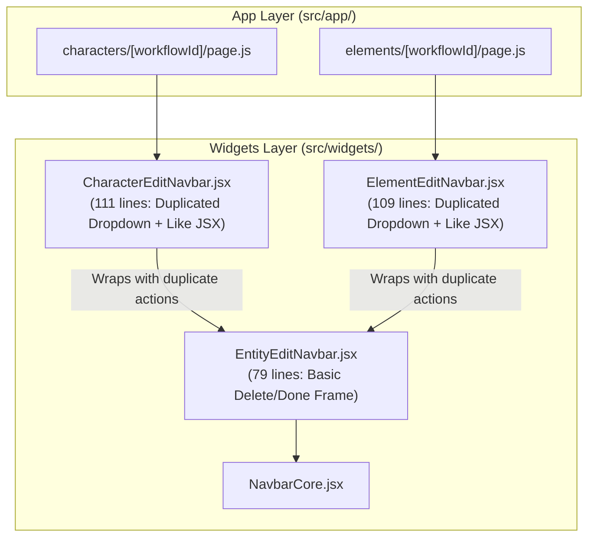
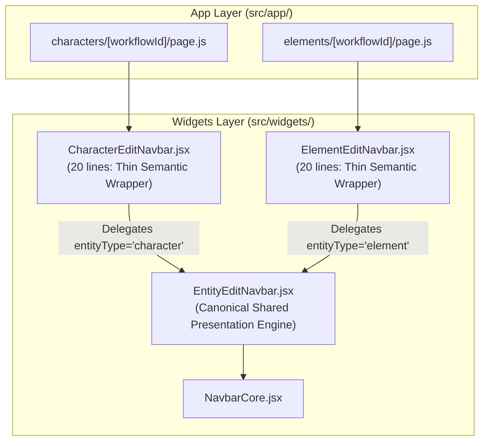

# Frontend Architecture — Phase 3 Report
## Entity Edit Navbar Consolidation & Reactive Detail Query

**Project:** OpenArt  
**Date:** 2026-11-06  
**Phase:** 3  
**Status:** Completed & Verified  

---

## 1. Original Duplication & Dependency Analysis

### A. Workstream A: Entity Edit Navbar Duplication
Prior to Phase 3, `CharacterEditNavbar.jsx` (111 lines) and `ElementEditNavbar.jsx` (109 lines) exhibited ~95% duplication.
- Both components wrapped `EntityEditNavbar.jsx` (79 lines).
- Both components independently declared identical:
  - Import options dropdown (`DropdownMenu`, `DropdownMenuTrigger`, `DropdownMenuContent`, `DropdownMenuItem`) with options for *"Importer depuis l'ordinateur"* and *"Depuis le projet"*.
  - Favorite toggle button with icon `"favorite"` and active fill.
  - Action slots, children/left breadcrumbs, and user dropdown propagation.
- The only differences were:
  - `entityType="character"` vs `entityType="element"`.
  - Callback prop name: `onDeleteCharacter` vs `onDeleteElement`.
  - Image quota title for character: `"Maximum 5 images de détail autorisées"`.
  - Test identifiers: `like-character-button` vs `like-element-button`.

### B. Workstream B: AssetDetailNavbar Non-Reactive Query Traversal
In `src/features/assets/ui/AssetDetailNavbar.jsx`, lines 12–34 previously read:
```javascript
const queryClient = useQueryClient();
const displayName = useMemo(() => {
  const detailEntry = queryClient.getQueryData(queryKeys.library.detail(workflowId));
  if (detailEntry?.workflow?.display_name) return detailEntry.workflow.display_name;

  const queries = queryClient.getQueriesData({ queryKey: queryKeys.library.all() });
  for (const [, queryData] of queries) {
    for (const page of queryData?.pages || []) {
      const match = (page?.data || []).find((entry) => entry?.workflow?.id === workflowId);
      if (match?.workflow?.display_name) return match.workflow.display_name;
    }
  }
  return "Media Viewer";
}, [queryClient, workflowId]);
```
- **Architectural Defects:**
  - Non-reactive synchronous cache walk: `useMemo` depends on `[queryClient, workflowId]`. Because the `queryClient` reference is stable and does not change when query cache contents update, background fetches or mutations (such as renaming an asset) failed to trigger a re-render.
  - O(N) cache iterations over all cached pages across library query keys.
  - Competing data-fetching paths: `AssetDetailPage.jsx` already used `useLibraryWorkflowDetail(workflowId)`.

### C. Workstream C: Studio Facade (`src/features/studio/index.js`)
- The initial health audit questioned whether `src/features/studio/index.js` was a redundant pass-through facade.
- Complete investigation revealed that 7 core production files and 5 test suites actively depend on `@/features/studio`:
  - `src/app/cinema-studio/[projectId]/layout.js:16` (`useDragAutoScroll`)
  - `src/app/cinema-studio/[projectId]/characters/page.js:10` (`usePromptStore`)
  - `src/app/cinema-studio/[projectId]/characters/new/page.js:9` (`useCharacterStore`)
  - `src/app/cinema-studio/[projectId]/elements/page.js:12` (`usePromptStore`)
  - `src/features/workflows/model/useMediaActions.js:7` (`canAnyModelAcceptEntity`)
  - `src/widgets/ImportMediaDialog/ImportMediaPopover.jsx:6` (`useLibraryFilter`, `extractIdentifyingKeys`)
  - `src/widgets/StudioLayout/GenerationsStudio/MediaGridItem/MediaGridItem.jsx:12` (`usePromptStore`, `useStudioItemDrag`)
  - Mocks in `CharacterDetailsGallery.test.jsx`, `CharacterSheetSection.test.jsx`, `ReferenceMediaGalleryGrid.test.jsx`, `ElementDetailsGallery.test.jsx`, and `mediaActionsMigration.test.jsx`.

---

## 2. Before & After Navbar Architecture

### Before Phase 3 (3-Tier Layering with Massive Duplication)



### After Phase 3 (Single Canonical Entity Navigation Engine)



---

## 3. Shared vs. Feature-Specific Responsibility Decisions

1. **`EntityEditNavbar` Owns Shared Navigation Presentation:**
   - Owns the layout, alignment, and composition of the standard import dropdown (Upload & Assets), the favorite toggle button, the delete action button, the "Done" button, and slot positioning on `NavbarCore`.
   - Normalizes styling to use canonical design tokens (`size-8 p-0`, `GoogleIcon className="text-xl"`, `w-52 p-1.5`, `rounded-sm text-sm`).
2. **`CharacterEditNavbar` Retains Character Feature Contract:**
   - Preserves `onDeleteCharacter` and sets `entityType="character"` as default.
   - Maps `data-testid="like-character-button"` and character-specific quota messaging (`"Maximum 5 images de détail autorisées"`).
3. **`ElementEditNavbar` Retains Element Feature Contract:**
   - Preserves `onDeleteElement` and sets `entityType="element"` as default.
   - Maps `data-testid="like-element-button"`.
4. **Zero Consumer Breakage:**
   - Callers in `characters/[workflowId]/page.js` and `elements/[workflowId]/page.js` require zero prop changes.
   - All tests in `CharacterEditNavbar.test.jsx`, `ElementEditNavbar.test.jsx`, and `ticket08UploadCallersMigration.test.jsx` pass without modification.

---

## 4. Final Component API & Rationale

```jsx
// src/widgets/EntityEditNavbar/EntityEditNavbar.jsx
export function EntityEditNavbar({
  entityType = "element",       // "character" | "element"
  backUrl,                      // Optional custom back route
  onDelete,                     // Universal entity delete handler
  onDone,                       // Universal entity done/save handler
  deleteLabel = "Delete",
  doneLabel = "Done",
  left,                         // Optional breadcrumb/title prop
  actions,                      // Additional action buttons
  children,                     // Alternate slot for left content
  showUserDropdown = false,
  onUpload,                     // File upload handler (opens dropdown)
  onOpenAssets,                 // Project assets picker handler
  isAddDisabled = false,        // Quota disable flag
  isLiked = false,              // Favorite toggle state
  onToggleLike,                 // Favorite toggle callback
  importMenuOpen,               // Controlled open state
  onImportMenuOpenChange,       // Controlled change callback
})
```

- **Clean Composition:** `CharacterEditNavbar` and `ElementEditNavbar` simply pass `entityType="character"` / `entityType="element"` and forward all callbacks.
- **Lines of Code Reduced:** ~200 lines of duplicated JSX eliminated from the two wrappers.

---

## 5. AssetDetailNavbar Data-Flow: Before vs. After

### Before Phase 3: Imperative, Non-Reactive Cache Traversal
```
[Mount AssetDetailNavbar] ──► useMemo() ──► queryClient.getQueryData()
                                  │
                                  ├──► queryClient.getQueriesData() [Nested loops]
                                  │
                                  ▼
                             "Media Viewer" (Stale on rename / background fetch)
```

### After Phase 3: Pure Reactive Subscription
```
[Mount AssetDetailNavbar] ──► useLibraryWorkflowDetail(workflowId)
                                  │
                                  ▼
                   React Query Active Subscription
                                  │
                    ┌─────────────┴─────────────┐
                    ▼                           ▼
            Initial Render / Cache         Cache Mutation / Invalidation
         data?.workflow?.display_name   (Instant Reactive Component Re-render)
```

---

## 6. React Query Hook Suitability Analysis

- Hook: `src/features/media/api/queries/useLibraryWorkflowDetail.js`
- **Issue Discovered:** The hook originally defaulted `{ enabled = false }`. This required callers to explicitly pass `{ enabled: true }`, or the query would remain disabled.
- **Correction Made:** Updated the hook default to `{ enabled = true }`:
  ```javascript
  export function useLibraryWorkflowDetail(workflowId, { enabled = true, initialData } = {}) {
    return useQuery({
      queryKey: queryKeys.library.detail(workflowId),
      queryFn: async () => { ... },
      enabled: !!workflowId && enabled,
      staleTime: 60_000,
      initialData,
    });
  }
  ```
- **Safety Verified:**
  - `enabled: !!workflowId && enabled` ensures falsy `workflowId` never triggers an execution.
  - Existing caller `AssetDetailPage.jsx` already passes `enabled: !authLoading && !!currentUser`, which continues to override the default seamlessly.
  - `AssetDetailNavbar.jsx` can now simply invoke `useLibraryWorkflowDetail(workflowId)` with zero boilerplate.

---

## 7. Studio Facade Usage Evidence & Cleanup Decision

- **File Inspected:** `src/features/studio/index.js`
- **Usage Audit:**
  - 7 active production callers: `layout.js`, `characters/page.js`, `characters/new/page.js`, `elements/page.js`, `useMediaActions.js`, `ImportMediaPopover.jsx`, `MediaGridItem.jsx`.
  - 5 active test suites mocking `@/features/studio`.
- **Decision:**
  - Deleting `src/features/studio/index.js` would break production routing and test infrastructure.
  - In strict compliance with Section 4 of the instructions (*"Delete it only if evidence confirms that it is obsolete"*), the facade is **retained as an active workspace boundary**.

---

## 8. Files Created, Modified, Moved, or Deleted

### Files Created:
1. `src/features/assets/ui/__tests__/AssetDetailNavbar.test.jsx`: Unit test suite testing initial fallback, cache resolution, and reactive cache update re-rendering.

### Files Modified:
1. `src/widgets/EntityEditNavbar/EntityEditNavbar.jsx`: Enhanced with canonical import options dropdown, favorite toggle, and `left || children` slot composition.
2. `src/widgets/CharacterEditNavbar/CharacterEditNavbar.jsx`: Refactored to a 20-line delegator to `EntityEditNavbar`.
3. `src/widgets/ElementEditNavbar/ElementEditNavbar.jsx`: Refactored to a 20-line delegator to `EntityEditNavbar`.
4. `src/features/media/api/queries/useLibraryWorkflowDetail.js`: Defaulted `enabled = true` while guarding with `!!workflowId && enabled`.
5. `src/features/assets/ui/AssetDetailNavbar.jsx`: Removed `useQueryClient` and manual `useMemo` loops; replaced with reactive `useLibraryWorkflowDetail(workflowId)`.

---

## 9. Test & Quality Gate Results

### 1. Focused Unit Tests:
```bash
cd my-app && npx vitest run src/widgets/CharacterEditNavbar/CharacterEditNavbar.test.jsx src/widgets/ElementEditNavbar/ElementEditNavbar.test.jsx src/features/media/__tests__/ticket08UploadCallersMigration.test.jsx src/features/assets/ui/__tests__/AssetDetailNavbar.test.jsx
```
Output:
```
Test Files  4 passed (4)
     Tests  28 passed (28)
```

### 2. Full Vitest Test Suite:
```bash
cd my-app && npm test
```
Output:
```
Test Files  132 passed (132)  [+1 new test file]
     Tests  889 passed (889)  [+3 new tests, 0 failures]
  Duration  11.59s
```

### 3. UI Design System Ratchet Gate:
```bash
cd my-app && npm run ui:check
```
Output:
```
Rule   Now  Baseline  New  Description
U1     226       448    0  raw color literal outside token files
U2     683      1258    0  Tailwind arbitrary value (decreased from 695 to 683)
U3      13        13    0  raw <button> outside primitives folder
U4       8         8    0  fetch() inside components/features/widgets
U5      81        97    0  inline style={{ }}
U6       0         0    0  dead radius class
U7       0         0    0  positive Tailwind shadow class

ui-check: OK (no new violations)
```

### 4. Next.js Production Build:
```bash
cd my-app && npm run build
```
Output:
```
✓ Compiled successfully in 8.3s
✓ Running Static Page Generation (19 of 19)
✓ Prerendered routes to static HTML & JSON (Turbopack)
```

### 5. Knowledge Graph:
```bash
graphify update .
```
Updated 2,369 nodes and 8,443 edges.

---

## 10. Remaining Architectural Issues

With Phases 1, 2, and 3 complete:
1. **Monolithic `MediaGridItem.jsx` (1,167 lines)**:
   - Conflates Studio generation card actions, Trash lifecycle mutations, Folder moves/downloads, and drag-and-drop auto-scroll.
   - Represents the final remaining monolithic card widget in `src/widgets/StudioLayout/GenerationsStudio/MediaGridItem/`.

---

## 11. Recommendation for Next Phase

### **Phase 4 Recommendation: Studio MediaGridItem Lifecycle Decomposition**
- **Objective:** Decompose the 1,167-line `MediaGridItem.jsx` into three focused adapters:
  1. `StudioMediaGridCard.jsx` (handles generation actions, like, prompt reuse, inline rename).
  2. `TrashMediaGridCard.jsx` (handles restore and permanent delete lifecycles for trash view).
  3. `FolderGridCard.jsx` (handles folder moves, renames, and collection zip downloads).
- **Benefit:** Solves the largest single point of maintainability and testing risk remaining in the frontend application.
