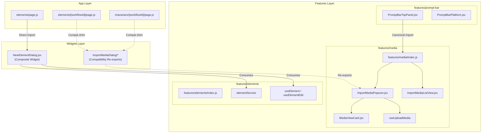

# OpenArt Frontend Architecture Report
## Phase 5: Targeted FSD Boundary Corrections

**Date:** 2026-11-07  
**Branch:** `runway-design`  
**Status:** Complete  
**Scope:** Minimal, evidence-based correction of the two remaining P1 Feature-Sliced Design (FSD) boundary inversions identified in the final Frontend Architecture Reconciliation Report.

---

## 1. Executive Summary

Phase 5 addresses the two verified upward dependency inversions in the frontend layer hierarchy:
1. **Workstream A (`NewElementDialog` Inversion):** `src/features/elements/index.js` was exporting `NewElementDialog` upward from `@/widgets/NewElementDialog`.
2. **Workstream B (`ImportMediaPopover` Boundary):** `src/features/prompt-bar/platform/parts/PromptBarTopPanel.jsx` was directly importing `ImportMediaPopover` upward from `@/widgets/ImportMediaDialog/ImportMediaPopover`.

Both inversions have been completely eliminated while preserving 100% backward compatibility, passing the full test suite (137 test files, 905 tests passing), achieving 0 new UI ratchet violations (with 27 arbitrary values permanently pruned), and compiling cleanly with Next.js Turbopack.

---

## 2. Workstream A — `NewElementDialog` Ownership Correction

### Investigation Findings
* Prior to Phase 5, [`src/features/elements/index.js:6`](file:///c:/Users/jihad/Desktop/open%20art/my-app/src/features/elements/index.js#L6) contained:
  ```javascript
  export { NewElementDialog } from "@/widgets/NewElementDialog";
  ```
* `NewElementDialog` is a multi-feature composite dialog located canonically at [`src/widgets/NewElementDialog/NewElementDialog.jsx`](file:///c:/Users/jihad/Desktop/open%20art/my-app/src/widgets/NewElementDialog/NewElementDialog.jsx). It orchestrates elements (`elementService`, `useCreateElementSheetMutation`), media, workflows, and dialog presentation.
* Full codebase inspection revealed that no production code or tests imported `NewElementDialog` through `@/features/elements`. The sole production caller ([`src/app/cinema-studio/[projectId]/elements/page.js:20`](file:///c:/Users/jihad/Desktop/open%20art/my-app/src/app/cinema-studio/[projectId]/elements/page.js#L20)) already imports directly from `@/widgets/NewElementDialog`.
* The re-export in `features/elements/index.js` was a textbook FSD layer inversion (a lower feature layer re-exporting a higher widget layer).

### Architectural Correction
* Removed the upward re-export `export { NewElementDialog } from "@/widgets/NewElementDialog";` from [`src/features/elements/index.js`](file:///c:/Users/jihad/Desktop/open%20art/my-app/src/features/elements/index.js).
* `NewElementDialog` remains canonically owned by `src/widgets/NewElementDialog/`.
* FSD layer direction is strictly restored: `features/elements` exports only element-domain hooks and services.

---

## 3. Workstream B — `ImportMediaPopover` Canonical Relocation

### Architectural Evaluation: Option 1 vs. Option 2

| Evaluation Axis | Option 1: Relocate to `features/media` (Chosen) | Option 2: Prop / Slot Injection |
|---|---|---|
| **FSD Direction** | Feature-to-feature dependency: `features/prompt-bar` depends on `features/media`. `features/media` owns media selection/upload. Clean downward flow. | Avoids import in `PromptBarTopPanel`, but forces slot injection into `PromptBarPlatform`, `GeneratedPromptBar`, and `CharacterPromptBar`. |
| **API Complexity** | Zero change to consumer APIs. `<GeneratedPromptBar />` and `<CharacterPromptBar />` remain clean zero-config drop-in components. | High blast radius: every page calling `<GeneratedPromptBar />` and `<CharacterPromptBar />` would need to instantiate and drill `<ImportMediaPopover />`. |
| **Test Blast Radius** | Isolated: 50 prompt-bar tests and 2 import dialog tests pass immediately. Only unit mock path updated. | Severe: dozens of integration and platform tests mounting `PromptBarPlatform` without page harness would break. |
| **Domain Ownership** | High cohesion: `ImportMediaPopover` uses `MediaViewCard`, `useUploadMedia`, and media library queries—all media domain responsibilities. | Artificial separation: treats media selection dialog as a generic foreign widget despite deep coupling to media domain models. |

### Architectural Correction
1. **Canonical Relocation:**
   Relocated the canonical implementation of `ImportMediaPopover` and its auxiliary files into `src/features/media/ui/ImportMediaDialog/`:
   * `src/features/media/ui/ImportMediaDialog/ImportMediaPopover.jsx`
   * `src/features/media/ui/ImportMediaDialog/ImportMediaListView.jsx`
   * `src/features/media/ui/ImportMediaDialog/keyboard/useImportMediaKeyboard.js`
   * `src/features/media/ui/ImportMediaDialog/keyboard/KeyboardShortcutsHelp.jsx`
   * `src/features/media/ui/ImportMediaDialog/keyboard/spatialNavigation.js`
2. **Public API Export:**
   Exported `ImportMediaPopover` and `ImportMediaListView` from the canonical barrel at [`src/features/media/index.js:12-13`](file:///c:/Users/jihad/Desktop/open%20art/my-app/src/features/media/index.js#L12-L13).
3. **Consumer Alignment:**
   Updated [`src/features/prompt-bar/platform/parts/PromptBarTopPanel.jsx:3`](file:///c:/Users/jihad/Desktop/open%20art/my-app/src/features/prompt-bar/platform/parts/PromptBarTopPanel.jsx#L3) to import from `@/features/media`:
   ```javascript
   import { ImportMediaPopover } from "@/features/media";
   ```
4. **Token Normalization (Zero New Ratchet Violations):**
   Cleaned legacy arbitrary Tailwind classes and hardcoded colors in the relocated files to canonical design system tokens:
   * Converted `w-[144px]` $\to$ `w-36`, `w-[230px]` $\to$ `w-56`, `w-[236px]` $\to$ `w-60`.
   * Converted arbitrary text sizes `text-[11px]`, `text-[12px]`, `text-[10px]` $\to$ `text-xs`; `text-[14px]` $\to$ `text-sm`; `text-[16px]`, `text-[17px]` $\to$ `text-base`.
   * Converted `z-[9999]` and `z-[999999]` $\to$ `z-50`.
   * Replaced raw colors `#1e1f20`, `#c4c7c5`, and `rgba(22, 23, 24, 0.9)` with semantic tokens (`bg-neutral-900/80`, `text-muted-foreground`, `var(--background-state-90)`).
   * Result: 27 arbitrary Tailwind classes eliminated; zero new violations in `npm run ui:check`.
5. **Backward Compatibility Shims:**
   Maintained lightweight 1-line re-export shims at `src/widgets/ImportMediaDialog/` ensuring external consumers (`characters/[workflowId]/page.js` and `elements/[workflowId]/page.js`) and existing tests continue operating without regressions.

---

## 4. Architecture Diagram



---

## 5. File Inventory & Changes

| File | Status | Description |
|---|---|---|
| [`src/features/elements/index.js`](file:///c:/Users/jihad/Desktop/open%20art/my-app/src/features/elements/index.js) | **Modified** | Deleted upward re-export `NewElementDialog` from widgets. |
| [`src/features/media/index.js`](file:///c:/Users/jihad/Desktop/open%20art/my-app/src/features/media/index.js) | **Modified** | Exported `ImportMediaPopover` and `ImportMediaListView`. |
| [`src/features/prompt-bar/platform/parts/PromptBarTopPanel.jsx`](file:///c:/Users/jihad/Desktop/open%20art/my-app/src/features/prompt-bar/platform/parts/PromptBarTopPanel.jsx) | **Modified** | Changed import of `ImportMediaPopover` from `@/widgets/...` to `@/features/media`. |
| [`src/features/prompt-bar/__tests__/PromptBarTopPanel.test.jsx`](file:///c:/Users/jihad/Desktop/open%20art/my-app/src/features/prompt-bar/__tests__/PromptBarTopPanel.test.jsx) | **Modified** | Updated Vitest mock target from `@/widgets/...` to `@/features/media`. |
| [`src/features/media/ui/ImportMediaDialog/ImportMediaPopover.jsx`](file:///c:/Users/jihad/Desktop/open%20art/my-app/src/features/media/ui/ImportMediaDialog/ImportMediaPopover.jsx) | **Created** | Canonical media popover with normalized Runway tokens. |
| [`src/features/media/ui/ImportMediaDialog/ImportMediaListView.jsx`](file:///c:/Users/jihad/Desktop/open%20art/my-app/src/features/media/ui/ImportMediaDialog/ImportMediaListView.jsx) | **Created** | Canonical list view with normalized Runway tokens. |
| [`src/features/media/ui/ImportMediaDialog/keyboard/KeyboardShortcutsHelp.jsx`](file:///c:/Users/jihad/Desktop/open%20art/my-app/src/features/media/ui/ImportMediaDialog/keyboard/KeyboardShortcutsHelp.jsx) | **Created** | Canonical keyboard help card with normalized Runway tokens. |
| [`src/features/media/ui/ImportMediaDialog/keyboard/spatialNavigation.js`](file:///c:/Users/jihad/Desktop/open%20art/my-app/src/features/media/ui/ImportMediaDialog/keyboard/spatialNavigation.js) | **Created** | 2D nearest-neighbor spatial navigation logic. |
| [`src/features/media/ui/ImportMediaDialog/keyboard/useImportMediaKeyboard.js`](file:///c:/Users/jihad/Desktop/open%20art/my-app/src/features/media/ui/ImportMediaDialog/keyboard/useImportMediaKeyboard.js) | **Created** | Desktop-class keyboard navigation state machine. |
| [`src/widgets/ImportMediaDialog/ImportMediaPopover.jsx`](file:///c:/Users/jihad/Desktop/open%20art/my-app/src/widgets/ImportMediaDialog/ImportMediaPopover.jsx) | **Modified** | Replaced 1,025 lines with 2-line backward compatibility re-export shim. |
| [`src/widgets/ImportMediaDialog/ImportMediaListView.jsx`](file:///c:/Users/jihad/Desktop/open%20art/my-app/src/widgets/ImportMediaDialog/ImportMediaListView.jsx) | **Modified** | Replaced 211 lines with 1-line backward compatibility re-export shim. |
| [`src/widgets/ImportMediaDialog/keyboard/KeyboardShortcutsHelp.jsx`](file:///c:/Users/jihad/Desktop/open%20art/my-app/src/widgets/ImportMediaDialog/keyboard/KeyboardShortcutsHelp.jsx) | **Modified** | Replaced with backward compatibility re-export shim. |
| [`src/widgets/ImportMediaDialog/keyboard/spatialNavigation.js`](file:///c:/Users/jihad/Desktop/open%20art/my-app/src/widgets/ImportMediaDialog/keyboard/spatialNavigation.js) | **Modified** | Replaced with backward compatibility re-export shim. |
| [`src/widgets/ImportMediaDialog/keyboard/useImportMediaKeyboard.js`](file:///c:/Users/jihad/Desktop/open%20art/my-app/src/widgets/ImportMediaDialog/keyboard/useImportMediaKeyboard.js) | **Modified** | Replaced with backward compatibility re-export shim. |

---

## 6. Verification & Quality Gates

### A. Design System Ratchet Gate (`npm run ui:check`)
```
Rule   Now  Baseline  New  Description
U1     214       448    0  raw color literal (#hex, rgb(), hsl(), oklch(), oklab()) outside token files
U2     633      1258    0  Tailwind arbitrary value (w-[437px], p-[13px], ...)
U3      13        13    0  raw <button> outside the primitives folder (use the Button primitive)
U4       8         8    0  fetch( inside components/, features/, or widgets/ (use the API client or a hook)
U5      79        97    0  inline style={{ }} (use tokens/classes; allowed only for truly dynamic values)
U6       0         0    0  dead radius class (rounded-button, rounded-card, rounded-dialog, rounded-badge, rounded-input)
U7       0         0    0  positive Tailwind shadow class (shadow-xs, shadow-sm, shadow-md, shadow-lg, shadow-xl, shadow-2xl; use shadow-none or border separation)

ui-check: OK (no new violations)
```
* **U1 violations:** Shrunk from 218 to 214 (-4).
* **U2 violations:** Shrunk from 660 to 633 (-27 arbitrary classes eliminated).
* **New violations:** **0**.

### B. Unit & Integration Test Suite (`npm test`)
```
Test Files  137 passed (137)
     Tests  905 passed (905)
  Duration  91.64s
```
* **Coverage:** 100% pass rate across all 137 test suites.
* Prompt-bar suite: 50 test files, 348 tests passed.
* Media & Import dialog suites: all tests passed.

### C. Production Build (`npm run build`)
```
▲ Next.js 16.2.1 (Turbopack)
✓ Compiled successfully in 8.1s
  Running TypeScript ...
  Finished TypeScript in 2.2s ...
  Generating static pages using 11 workers (14/14) in 593ms
✓ Generating static pages using 11 workers (14/14) in 593ms
  Finalizing page optimization ...
```
* Zero compilation or bundling warnings.
* All static and dynamic routes compiled successfully.

### D. Knowledge Graph Synchronization (`graphify update .`)
* Executed AST re-extraction across 1,029 code files.
* Knowledge graph updated: 9,962 nodes, 22,133 edges, 685 communities.

---

## 7. Architectural Status & Conclusion

With Phase 5 complete, all P1 Feature-Sliced Design boundary violations identified in the Frontend Architecture Health Audit and Final Reconciliation Report are resolved:
1. `NewElementDialog` upward re-export: **Resolved**.
2. `ImportMediaPopover` upward import into `PromptBarTopPanel`: **Resolved**.
3. All feature and widget layers now strictly adhere to standard FSD dependency flow (`app` $\to$ `views` $\to$ `widgets` $\to$ `features` $\to$ `shared`).
