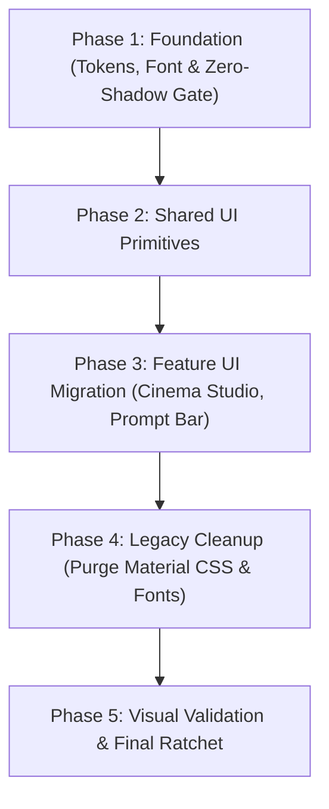

# Runway Design System — Revised Migration Execution Plan

**Author:** Antigravity / AI Agent  
**Date:** 2026-11-05  
**Branch:** `runway-design`  
**Specification Reference:** [`docs/design-system/runwayml.design.md`](file:///c:/Users/jihad/Desktop/open%20art/docs/design-system/runwayml.design.md)  
**Audit Reference:** [`docs/design-system/runway-full-compliance-audit.md`](file:///c:/Users/jihad/Desktop/open%20art/docs/design-system/runway-full-compliance-audit.md)  
**Token & Primitive Mapping:** [`docs/design-system/runway-to-openart-mapping.md`](file:///c:/Users/jihad/Desktop/open%20art/docs/design-system/runway-to-openart-mapping.md)  

---

## 1. Executive Reconciliation: Audit Verification & Reality Check

Before establishing the execution backlog, every claimed finding from the compliance audit was verified against the active codebase (`my-app/src`).

### 1.1 Verified Codebase Metrics vs. Audit Claims

| Metric | Audit Claim | Verified Count in Codebase | Verification & Overlap Analysis |
|---|---|---|---|
| **CSS Legacy Tokens** | 419 occurrences in `globals.css` | **415 occurrences** in `globals.css` | 306 definitions of `--mat-*`, 105 usages, 4 `--flow-*` defs. Lines 440–915 and 1025–1172. |
| **JSX Legacy Tokens** | 297 direct invocations | **211 occurrences across 24 files** | 137 `--mat-*`, 74 `--foreground-state-*`, 0 `--flow-*`. Concentrated in 12 shared UI primitives, 7 widgets, and 5 tests. |
| **Overlap Analysis** | *Unspecified in audit* | **0% Overlap** | CSS tokens are the *variable dictionary* in `globals.css`; JSX tokens are the *call-site consumers*. They must be eliminated from JSX first before deleting from CSS. |
| **Google Icons** | 228 occurrences in 46 files | **229 usages across 54 files** | Loaded via Google CDN font links in `layout.js` (`Material Symbols` and `Google Symbols`). Injects bulky Android/Material font glyphs. |
| **Lucide React Usage** | *Not reported in audit* | **44 files already importing `lucide-react`** | High-quality hairline SVG icons are already present and used across the codebase. |
| **Hardcoded Shadows** | 40+ positive shadows | **38 positive shadows across 20 files** | 100+ occurrences in JSX are already explicit `shadow-none` classes! Only 38 positive shadows (`shadow-2xl`, `shadow-xl`, `shadow-lg`, `shadow-md`, `shadow-sm`) remain. |
| **Non-Runway Radiuses** | 80 occurrences | **80 occurrences** (`rounded-xl` and `rounded-3xl`) | 12px (`rounded-xl`) and 24px (`rounded-3xl`) violate Runway's 4-tier scale (4px, 6px, 8px, 16px). |
| **Glassmorphism Blurs** | 87 occurrences | **87 occurrences** of `backdrop-blur-*` | Relics of Google Flow frosted glass in dialogs, dropdowns, and prompt bar. |

### 1.2 False Positives, Nuances & Necessary Exceptions

1. **"Photography instead of icons" does NOT mean zero UI icons:**
   - **Nuance:** Runway’s marketing pages showcase photography without decorative icon stamps. However, an interactive web application (video/image generation studio) requires navigational and functional action controls (Play, Pause, Close, Trash, Chevron, Settings, Checkmark, Copy, ArrowLeft).
   - **Ruling:** Eliminate *decorative* icon badges and illustrative glyphs. Replace all functional Google Material glyphs (`GoogleIcon`) with hairline, geometric SVG icons via `lucide-react` (`stroke-width={1.5}` or `1.25`, 16px default).
2. **Explicit `shadow-none` is NOT a violation:**
   - The codebase contains ~100 instances of `shadow-none` intentionally added to suppress default browser or legacy shadows. These are fully aligned with Runway’s zero-shadow mandate and will remain intact.
3. **Pills and Circular Geometry (`rounded-full`):**
   - Runway’s specification does not use circular buttons. However, OpenArt’s product UX requires pills for metadata tags, user avatars, toggle switches, and radio indicators. `rounded-full` remains explicitly permitted for these specific controls.
4. **Button Primary Contrast vs. Runway Transparent Primary:**
   - Runway specifies `button-primary` as transparent fill with white text and 1px `#27272a` border.
   - OpenArt brand guidelines require high contrast for primary actions (`#EFFE17` neon CTA or high-contrast white).
   - **Reconciliation:** Retain high-contrast for `variant="primary"` (preserving brand CTA), but update its typography from 12px (`text-xs`) to Runway’s 14px (`text-sm font-semibold`). Align `outline` and `secondary` directly with Runway’s transparent, 1px-bordered button recipes.

---

## 2. Core Visual Foundations Architecture

### 2.1 The OpenArt × Runway Color Unification

```
┌────────────────────────────────────────────────────────────────────────┐
│ RUNWAY RESTRAINED FOUNDATION                                           │
│ Canvas: #000000 (Pure Black)                                           │
│ Panels: #131314 (Runway Dark Surface / OpenArt Panel)                  │
│ Cards:  #1e1f20 (Runway Charcoal / OpenArt Card)                       │
│ Hairline Borders: 1px #27272a (rgba(255, 255, 255, 0.10))              │
│ Zero Shadows: All surfaces flat, depth defined by 1px hairline         │
├────────────────────────────────────────────────────────────────────────┤
│ RUNWAY COOL-SLATE NEUTRALS (NEW)                                       │
│ Primary Text:      #ffffff (White, 100% opacity)                       │
│ Secondary / Meta:  #767d88 (Cool Slate — Runway's signature neutral)   │
│ Tertiary / Subtle: #7d848e (Mid Slate — restrained body/caption)       │
├────────────────────────────────────────────────────────────────────────┤
│ PRESERVED OPENART BRAND ACCENTS (EXCLUSIVELY FOR ACTIONS & SIGNALS)     │
│ Primary Brand CTA: #EFFE17 (Neon Yellow — high-impact conversion)      │
│ Links & Focus:     #a8c7fa (Soft Accent Blue)                          │
│ Danger / Delete:   #fe6e6e (Soft Coral Red)                            │
│ Success / Ready:   #80da88 (Soft Mint Green)                           │
│ Warning / Pending: #fcbd00 (Amber Gold)                                │
└────────────────────────────────────────────────────────────────────────┘
```

### 2.2 Typography Hierarchy (`Inter` as `abcNormal` Surrogate)

Per Runway specification line 45: *"Inter or DM Sans are the closest open-source substitutes; both handle the geometric proportions cleanly."*

- **Font Family:** `Inter, -apple-system, BlinkMacSystemFont, "Segoe UI", Roboto, sans-serif` loaded natively via `next/font/google`.
- **Button:** 14px (`text-sm`), 600 weight, line-height 1.25.
- **Micro-Tag / Label:** 11px (`text-[11px]`), 450/500 weight, uppercase, tracking +0.35px.
- **Card Title:** 24px (`text-2xl`), 400 weight, line-height 1.00, tracking 0px.
- **Section Heading:** 36px–40px (`text-4xl`), 400 weight, line-height 1.00, tracking -0.9px to -1.0px.
- **Display Hero:** 48px (`text-5xl`), 400 weight, line-height 1.00, tracking -1.2px.

### 2.3 Radius Geometry (Strict 4-Tier Scale)

| Token | Class | Pixel Size | Permitted Applications |
|---|---|---|---|
| `sharp` | `rounded-sm` | **4px** | Buttons, text inputs, dropdown menu items, badges. |
| `subtle` | `rounded-md` | **6px** | Tooltips, compact floating pills, small media overlays. |
| `comfortable` | `rounded-lg` | **8px** | Media cards, panels, dropdown shells, drawer containers. |
| `generous` | `rounded-2xl` | **16px** | Dialogs, modal sheets, full-page alert containers. |
| *Exemption* | `rounded-full` | **9999px** | Avatars, toggle switches, radio indicators, pill chips. |
| **Prohibited** | `rounded-xl` (12px), `rounded-3xl` (24px) | **BANNED** | Must be mapped to `rounded-lg` or `rounded-2xl`. |

---

## 3. Five-Phase Implementation Roadmap (Vertical Slices)



---

### Phase 1 — Foundation: Tokens, Typography, and Universal Zero-Shadow Gate

#### Slice 1.1: Font Loading & Global Typography Engine
- **Files:**
  - [`my-app/src/app/layout.js`](file:///c:/Users/jihad/Desktop/open%20art/my-app/src/app/layout.js)
  - [`my-app/src/app/globals.css`](file:///c:/Users/jihad/Desktop/open%20art/my-app/src/app/globals.css)
- **Changes:**
  - Load `Inter` from `next/font/google` with `display: "swap"`, `subsets: ["latin"]`, and expose `--font-inter`.
  - Update `--font-sans` in `globals.css` and `@theme inline` to `"Inter", var(--font-inter), sans-serif`.
  - Remove Google Sans `@font-face` blocks from `globals.css` (lines 18–65).
  - Retain local font files in `/public/fonts/` temporarily until Phase 4 validation.
- **Dependencies:** None.
- **Risks:** Text reflow across existing layouts due to font metric differences between Google Sans and Inter.
- **Acceptance Criteria:** `font-sans` resolves to `Inter`; typography scales render without visual overflow.
- **Tests & Verification:** `npm run ui:check`, `npx vitest run`, Next.js build.

#### Slice 1.2: Runway Semantic Neutral Tokens & Border Variables
- **Files:**
  - [`my-app/src/app/globals.css`](file:///c:/Users/jihad/Desktop/open%20art/my-app/src/app/globals.css)
- **Changes:**
  - Add `--color-cool-slate: #767d88;` and `--color-mid-slate: #7d848e;` into `@theme inline`.
  - Define semantic utilities: `text-cool-slate`, `text-mid-slate`, `border-hairline` (1px `#27272a` / `rgba(255,255,255,0.1)`).
  - Explicitly map `--surface-canvas: #000000`, `--surface-panel: #131314`, `--surface-card: #1e1f20`, `--surface-elevated: #282a2c`.
- **Dependencies:** Slice 1.1.
- **Risks:** Low. Purely additive to Tailwind CSS v4 `@theme`.
- **Acceptance Criteria:** `text-cool-slate` and `border-hairline` compile to valid CSS classes.

#### Slice 1.3: Universal Zero-Shadow & Radius Pruning in JSX
- **Files:**
  - 20 files containing positive shadows and 80 occurrences of `rounded-xl`/`rounded-3xl` (e.g. [`CoreMediaItemView.jsx`](file:///c:/Users/jihad/Desktop/open%20art/my-app/src/widgets/CoreMediaItemView/CoreMediaItemView.jsx), [`MediaGridItem.jsx`](file:///c:/Users/jihad/Desktop/open%20art/my-app/src/widgets/StudioLayout/GenerationsStudio/MediaGridItem/MediaGridItem.jsx), [`HowToDrawer.jsx`](file:///c:/Users/jihad/Desktop/open%20art/my-app/src/components/cinema-studio/elements/HowToDrawer.jsx), [`TrashView.jsx`](file:///c:/Users/jihad/Desktop/open%20art/my-app/src/features/trash/ui/TrashView.jsx), [`FlowCharacterImagePreview.jsx`](file:///c:/Users/jihad/Desktop/open%20art/my-app/src/components/cinema-studio/characters/FlowCharacterImagePreview.jsx)).
  - [`my-app/scripts/ui-check.cjs`](file:///c:/Users/jihad/Desktop/open%20art/my-app/scripts/ui-check.cjs)
- **Changes:**
  - Strip positive shadow classes (`shadow-2xl`, `shadow-xl`, `shadow-lg`, `shadow-md`, `shadow-sm`) from component JSX; rely on 1px hairline border separation.
  - Map `rounded-xl` (12px) to `rounded-lg` (8px) for cards/panels, and `rounded-3xl` (24px) to `rounded-2xl` (16px) for dialogs/sheets.
  - Add Rule **U7** to `scripts/ui-check.cjs` forbidding positive `shadow-(xs|sm|md|lg|xl|2xl)` in `src/`.
- **Dependencies:** Slice 1.2.
- **Risks:** Visual contrast reduction on dark-on-dark components if hairline borders are missing.
- **Acceptance Criteria:** Zero positive shadows remain in JSX; `ui:check` passes with zero U7 violations.

---

### Phase 2 — Shared UI Components Migration

#### Slice 2.1: Button Primitive Runway Alignment
- **Files:**
  - [`my-app/src/shared/ui/button.jsx`](file:///c:/Users/jihad/Desktop/open%20art/my-app/src/shared/ui/button.jsx)
  - [`my-app/src/shared/ui/__tests__/button.test.jsx`](file:///c:/Users/jihad/Desktop/open%20art/my-app/src/shared/ui/__tests__/button.test.jsx)
- **Changes:**
  - Update base typography from `text-xs` (12px) to `text-sm font-semibold` (14px, weight 600) matching Runway `{typography.button}`.
  - Replace all legacy `--mat-sys-*` and `--foreground-state-*` variables with semantic classes:
    - `secondary`: `bg-surface-elevated text-white hover:bg-white/10`
    - `outline`: `border border-white/10 bg-transparent text-white hover:bg-white/5`
    - `ghost`: `bg-transparent text-white/90 hover:bg-white/10 hover:text-white`
    - `danger`: `bg-transparent text-red-400 hover:bg-red-500/10 hover:text-red-300`
    - `link`: `text-accent hover:underline`
  - Remove dead CSS selectors: `[&_mat-icon]`, `[&_.google-symbols]`.
- **Dependencies:** Phase 1.
- **Risks:** Slight 2px height change if call sites depended on 12px text without explicit height.
- **Acceptance Criteria:** All 6 variants render cleanly; 37/37 UI tests pass.

#### Slice 2.2: Dialog, Modal & Overlay System (Eliminating Glassmorphism)
- **Files:**
  - [`my-app/src/shared/ui/dialog.jsx`](file:///c:/Users/jihad/Desktop/open%20art/my-app/src/shared/ui/dialog.jsx)
  - [`my-app/src/widgets/dialogs/ConfirmDeleteDialog.jsx`](file:///c:/Users/jihad/Desktop/open%20art/my-app/src/widgets/dialogs/ConfirmDeleteDialog.jsx)
  - [`my-app/src/widgets/NewElementDialog/NewElementDialog.jsx`](file:///c:/Users/jihad/Desktop/open%20art/my-app/src/widgets/NewElementDialog/NewElementDialog.jsx)
- **Changes:**
  - Remove `backdrop-blur-md`, `backdrop-blur-xl` from dialog content wrappers.
  - Set solid opaque background: `bg-[#131314]` with 1px border `border-white/10` and `rounded-2xl` (16px generous).
  - Replace legacy `--mat-` variables in `dialog.jsx` with semantic surface tokens.
- **Dependencies:** Slice 2.1.
- **Risks:** None; improves rendering performance by eliminating expensive GPU blur compositing.
- **Acceptance Criteria:** Dialogs render on crisp opaque dark backgrounds with 1px border.

#### Slice 2.3: Menus, Selects & Dropdowns
- **Files:**
  - [`my-app/src/shared/ui/dropdown-menu.jsx`](file:///c:/Users/jihad/Desktop/open%20art/my-app/src/shared/ui/dropdown-menu.jsx)
  - [`my-app/src/shared/ui/context-menu.jsx`](file:///c:/Users/jihad/Desktop/open%20art/my-app/src/shared/ui/context-menu.jsx)
  - [`my-app/src/shared/ui/select.jsx`](file:///c:/Users/jihad/Desktop/open%20art/my-app/src/shared/ui/select.jsx)
  - [`my-app/src/shared/ui/DropdownShell.jsx`](file:///c:/Users/jihad/Desktop/open%20art/my-app/src/shared/ui/DropdownShell.jsx)
- **Changes:**
  - Replace 88 total `--mat-` and `--foreground-state-` variables with semantic classes (`bg-[#1e1f20]`, `border-white/10`, `text-white/90`, `hover:bg-white/10`).
  - Standardize menu geometry to `rounded-lg` (8px comfortable) and items to `rounded-sm` (4px sharp).
  - Remove all `backdrop-blur-*` classes.
- **Dependencies:** Slice 2.1.
- **Risks:** Dropdown item active state contrast.
- **Acceptance Criteria:** Dropdowns have flat dark `#1e1f20` surfaces with hairline borders; zero `--mat-` in menu JSX.

#### Slice 2.4: Form Controls (Input, Textarea, Switch, Slider, Tabs)
- **Files:**
  - [`my-app/src/shared/ui/input.jsx`](file:///c:/Users/jihad/Desktop/open%20art/my-app/src/shared/ui/input.jsx)
  - [`my-app/src/shared/ui/textarea.jsx`](file:///c:/Users/jihad/Desktop/open%20art/my-app/src/shared/ui/textarea.jsx)
  - [`my-app/src/shared/ui/switch.jsx`](file:///c:/Users/jihad/Desktop/open%20art/my-app/src/shared/ui/switch.jsx)
  - [`my-app/src/shared/ui/slider.jsx`](file:///c:/Users/jihad/Desktop/open%20art/my-app/src/shared/ui/slider.jsx)
  - [`my-app/src/shared/ui/tabs.jsx`](file:///c:/Users/jihad/Desktop/open%20art/my-app/src/shared/ui/tabs.jsx)
- **Changes:**
  - `input.jsx` & `textarea.jsx`: Replace 43 legacy tokens with `bg-[#131314]`, `border-white/10`, focus ring `ring-1 ring-white/20`.
  - `switch.jsx`: Remove `shadow-md` from thumb; use clean flat thumb with 1px border.
  - `slider.jsx`: Remove `shadow-md` from thumb.
  - `tabs.jsx`: Remove `shadow-xs` and `shadow-sm` from active tabs; use flat high-contrast active state.
- **Dependencies:** Slice 2.1.
- **Risks:** Focus accessibility states must remain visible.
- **Acceptance Criteria:** Clean flat controls adhering strictly to Runway's zero-shadow discipline.

---

### Phase 3 — Feature UI Migration

#### Slice 3.1: Cinema Studio & Media Cards
- **Files:**
  - [`my-app/src/widgets/CoreMediaItemView/CoreMediaItemView.jsx`](file:///c:/Users/jihad/Desktop/open%20art/my-app/src/widgets/CoreMediaItemView/CoreMediaItemView.jsx)
  - [`my-app/src/widgets/StudioLayout/GenerationsStudio/MediaGridItem/MediaGridItem.jsx`](file:///c:/Users/jihad/Desktop/open%20art/my-app/src/widgets/StudioLayout/GenerationsStudio/MediaGridItem/MediaGridItem.jsx)
  - [`my-app/src/components/cinema-studio/characters/CharacterCardKrea.jsx`](file:///c:/Users/jihad/Desktop/open%20art/my-app/src/components/cinema-studio/characters/CharacterCardKrea.jsx)
  - [`my-app/src/components/cinema-studio/elements/ElementCardKrea.jsx`](file:///c:/Users/jihad/Desktop/open%20art/my-app/src/components/cinema-studio/elements/ElementCardKrea.jsx)
- **Changes:**
  - Strip `shadow-2xl` and `hover:shadow-2xl` on media cards.
  - Ensure photographic full-bleed rendering with 8px corner radius (`rounded-lg`) matching Runway `{component.research-card}`.
  - Replace secondary label colors with `text-cool-slate` (`#767d88`).
- **Dependencies:** Phase 2.
- **Risks:** Media cards visually merging into background if border contrast is insufficient.
- **Acceptance Criteria:** Media items display with clean 8px radius and hairline borders without shadows.

#### Slice 3.2: Prompt Bar Restraint & Settings Popover
- **Files:**
  - [`my-app/src/features/prompt-bar/ui/common/selectors/FlowPromptBoxSettings.jsx`](file:///c:/Users/jihad/Desktop/open%20art/my-app/src/features/prompt-bar/ui/common/selectors/FlowPromptBoxSettings.jsx)
  - [`my-app/src/features/prompt-bar/platform/parts/PromptBarControlsRow.jsx`](file:///c:/Users/jihad/Desktop/open%20art/my-app/src/features/prompt-bar/platform/parts/PromptBarControlsRow.jsx)
- **Changes:**
  - Remove `backdrop-blur-2xl` and `shadow-2xl` from `FlowPromptBoxSettings.jsx:101`.
  - Transition settings popover to solid `bg-[#1e1f20]` with `border-white/10`.
  - Migrate legacy tokens inside prompt bar components to semantic classes.
- **Dependencies:** Phase 2.
- **Risks:** High-complexity component with multiple floating menus.
- **Acceptance Criteria:** Prompt bar settings popover opens cleanly as a flat surface without blur lag.

#### Slice 3.3: Functional Icon Consolidation (`lucide-react` Migration)
- **Files:**
  - 54 files consuming `GoogleIcon` (e.g. [`StudioNavbarLeft.jsx`](file:///c:/Users/jihad/Desktop/open%20art/my-app/src/widgets/StudioNavbar/ui/StudioNavbarLeft.jsx), [`ElementsEmptyState.jsx`](file:///c:/Users/jihad/Desktop/open%20art/my-app/src/components/cinema-studio/elements/ElementsEmptyState.jsx), [`MediaView.jsx`](file:///c:/Users/jihad/Desktop/open%20art/my-app/src/features/media/ui/MediaView.jsx)).
- **Changes:**
  - Map functional `GoogleIcon` instances to exact `lucide-react` equivalents (e.g., `close` → `X`, `delete`/`trash` → `Trash2`, `settings` → `Settings`, `play_arrow` → `Play`, `chevron_down` → `ChevronDown`).
  - Style with hairline stroke (`strokeWidth={1.5}` or `1.25`, `size-4`).
  - Eliminate purely decorative non-interactive icons.
- **Dependencies:** Phase 2.
- **Risks:** Missing icon mappings or differing icon dimensions.
- **Acceptance Criteria:** Zero functional regressions in studio navigation; chrome becomes lightweight and minimalist.

---

### Phase 4 — Legacy Cleanup (Purging Material CSS & Fonts)

#### Slice 4.1: Pruning Dead `--mat-*` and `--flow-*` CSS Definitions
- **Files:**
  - [`my-app/src/app/globals.css`](file:///c:/Users/jihad/Desktop/open%20art/my-app/src/app/globals.css)
- **Changes:**
  - Verify that 0 JSX files contain `var(--mat-)` or `var(--foreground-state-)`.
  - Safely delete obsolete Material variable declarations:
    - Lines 440–915 (Material Color Palette & System Tokens).
    - Lines 1025–1172 (Google Flow Menu & Container Overrides).
- **Dependencies:** Phase 2 and Phase 3 completed.
- **Risks:** Unintended styling break if an obscure component was overlooked.
- **Safety Gate:** Full AST scan of `my-app/src` before deletion.
- **Acceptance Criteria:** `globals.css` line count reduced by ~600 lines; zero broken CSS variable references.

#### Slice 4.2: Font & CDN Link Pruning
- **Files:**
  - [`my-app/src/app/layout.js`](file:///c:/Users/jihad/Desktop/open%20art/my-app/src/app/layout.js)
  - [`my-app/src/shared/ui/GoogleIcon.jsx`](file:///c:/Users/jihad/Desktop/open%20art/my-app/src/shared/ui/GoogleIcon.jsx)
- **Changes:**
  - Remove `<link>` tags for `Material Symbols Outlined` and `Google Symbols` from `<head>`.
  - Remove `googleSans` local font loader from `layout.js`.
  - Deprecate and remove `GoogleIcon.jsx`.
- **Dependencies:** Slice 3.3.
- **Risks:** Third-party widgets attempting to render Material icons.
- **Acceptance Criteria:** Zero external Google Font CDN network requests; page loads faster and hermetic.

---

### Phase 5 — Visual Validation & Final Quality Ratchet

#### Slice 5.1: Photographic Discipline & Contrast Validation
- **Actions:**
  - Verify photography dominance across Cinema Studio, Project Gallery, and Elements View.
  - Verify WCAG AA contrast compliance for `cool-slate` (`#767d88`) on `#000000` canvas (contrast ratio > 4.5:1 for normal text).
  - Test responsive desktop and mobile viewport behavior.

#### Slice 5.2: Verification Suite & Production Build
- **Actions:**
  - Run `npm run ui:check` (must pass with 0 new violations).
  - Run `npx vitest run` (all 819 tests must remain green).
  - Run `npm run build` (Next.js Turbopack build succeeds with 0 errors).

---

## 4. Key Architectural Decisions Requiring User Approval

Before initiating code modifications, the following 4 decisions require explicit user direction:

1. **Font Family Selection:**
   - *Recommendation:* Adopt `Inter` via Next.js `next/font/google` as the canonical sans-serif typeface, directly fulfilling Runway's specification as the primary open-source geometric equivalent to `abcNormal`.
   - *Alternative:* Retain Google Sans for body text while applying Runway's tighter line-heights and kerning.
2. **Icon Consolidation Strategy:**
   - *Recommendation:* Replace the 229 `GoogleIcon` font glyphs with hairline SVG icons from `lucide-react` (`strokeWidth={1.5}`), and remove the Google Symbols CDN font links to eliminate Android/Material visual weight.
   - *Alternative:* Retain `GoogleIcon` but strip out decorative instances only.
3. **Button Primary Treatment:**
   - *Recommendation:* Keep `variant="primary"` as a high-contrast action button (retaining OpenArt's conversion CTA), but upgrade its typography to 14px (`text-sm font-semibold`), and align `outline` and `secondary` with Runway's transparent 1px-bordered button design.
   - *Alternative:* Adopt Runway's transparent bordered button for `primary` as well.
4. **Enforcing Rule U7 (Zero Positive Shadows):**
   - *Recommendation:* Add Rule **U7** to `scripts/ui-check.cjs` forbidding positive Tailwind shadow classes (`shadow-xs` through `shadow-2xl`) across `my-app/src`, ratcheting the codebase to Runway's strict zero-shadow standard.

---

## 5. Recommended First Implementation Slice

### **Recommendation: Slice 1.3 — Universal Zero-Shadow & Radius Pruning in JSX**
Combined with **Slice 1.2 (Cool-Slate & Semantic Tokens)**.

### Why This Must Come First:
1. **Immediate High-Impact Compliance:** Hardcoded positive shadows (38 instances) and invalid 12px/24px radiuses (80 instances) are the most pervasive visual contradictions in the application. Pruning them immediately shifts the visual tone to Runway's flat, disciplined photographic aesthetic.
2. **Zero Functional Risk:** Removing `shadow-xl` or changing `rounded-xl` to `rounded-lg` does not alter component APIs, DOM hierarchy, state, or event handlers.
3. **Establishes the Ratchet Gate:** Adding Rule U7 to `scripts/ui-check.cjs` permanently locks in the zero-shadow discipline so that no subsequent PR or component edit can reintroduce drop shadows.
4. **Verifiable in 100% of Tests:** All 819 unit and integration tests will remain green because no functional logic is touched.
