# Design System Architecture Audit & Improvement Plan

**Status:** Complete Architectural Assessment & Strategic Roadmap  
**Scope:** Read-Only Audit across `design.md`, CSS Tokens, Tailwind v4 Theme, Shared Primitives, Feature Modules, and UI Quality Gates  
**Date:** 2026-11-05  
**Target Repository:** `my-app` (OpenArt / Labveil Frontend)  
**Branch:** `runway-design`  

---

## Section 1 — Executive Summary

### 1.1 Context and Purpose
Over the course of Phases P0, P1, and P2, the OpenArt frontend underwent critical visual alignment: 156 dead radius class occurrences were migrated across 57 files, a canonical Radix-based `<Slider />` primitive was introduced, non-legibility elevation shadows were pruned to `shadow-none`, and obsolete Angular Material/Flow CSS rules were deleted. Automated validation currently reports 100% test pass rate (787/787 tests across 121 files), Next.js Turbopack production compilation in 8.0s (0 errors across 31 routes), ESLint clean (0 errors), and the UI ratchet gate (`scripts/ui-check.cjs`) clean with zero new violations.

This audit evaluates the underlying architecture governing the design lifecycle:
$$\text{Design Specification} \longrightarrow \text{Design Tokens} \longrightarrow \text{CSS / Tailwind Theme} \longrightarrow \text{Shared UI Components} \longrightarrow \text{Feature Components} \longrightarrow \text{Validation Gates}$$

The purpose is to determine whether this architecture is clean, scalable, maintainable, and robust for both human developers and autonomous AI coding agents.

### 1.2 Biggest Strengths
1. **Unified Design Philosophy (`design.md`):** The repository has a comprehensive, authoritative specification defining Runway-style cinematic minimalism: full-bleed photography/video carrying the interface, 1px subtle borders (`border-white/10`), zero elevation box-shadows (`shadow-none`), sharp geometric hierarchy (4px buttons/inputs, 8px cards/popovers, 16px dialogs), 8px base spacing, and OLED canvas background (`#000000`).
2. **Canonical Primitive Layer (`src/shared/ui/*`):** High-quality shared primitives exist for `<Button>`, `<Input>`, `<Dialog>`, `<Card>`, `<Select>`, `<Popover>`, `<Slider>`, `<Switch>`, and `<Badge>`. Radix UI primitives handle accessibility and focus management, while `class-variance-authority` (cva) manages variants.
3. **Automated Ratchet Gate (`scripts/ui-check.cjs`):** The codebase enforces architectural boundaries via an automated ratchet script blocking raw color literals (U1), arbitrary Tailwind values (U2), raw `<button>` elements (U3), component fetch calls (U4), inline `style={{ }}` (U5), and dead radius classes (U6).
4. **Tailwind CSS v4 Inline Theme Integration:** CSS variables declared in `@theme inline` compile directly to standard Tailwind utility classes (`rounded-sm`, `rounded-lg`, `rounded-2xl`, `rounded-full`), providing a single global choke point for geometry and spacing.

### 1.3 Biggest Architectural Weaknesses
1. **Agent Rule vs. Spec Divergence (Critical Documentation Drift):** While `design.md` (root and `my-app/docs/ui-system/design.md`) defines sharp 4px buttons, 8px cards, and 16px dialogs, the agent instruction file `.agents/rules/frontend-design-system.md:20-25` still instructs AI agents to use deprecated Material Design 3 values: `rounded-button (12px)`, `rounded-card (16px)`, `rounded-dialog (24px)`, and `rounded-badge (8px)`. This creates direct confusion for AI coding agents.
2. **Inline Style vs. Tailwind Utility Conflicts in Menus:** In `src/shared/ui/dropdown-menu.jsx:43` and `src/shared/ui/context-menu.jsx:83, 111`, an inline style `borderRadius: "var(--mat-menu-container-shape, 8px)"` is hardcoded alongside Tailwind class `rounded-lg`. Because `globals.css:345` sets `--mat-menu-container-shape: var(--radius-2xl, 16px)`, the inline style overrides `rounded-lg`, causing standard dropdown menus (including `UserDropdown.jsx`) to render at 16px instead of the canonical 8px specified in `design.md:78`.
3. **Primitive Gaps Triggering Call-Site Restyling:** Certain common UI patterns lack first-class primitive support:
   - `<ButtonGroup>` has no `pill` variant, forcing `MediaGridItem.jsx:458` to pass `className="bg-white/60 backdrop-blur-md rounded-full border-0 border-none"`.
   - `<Button>` has no circular icon size (e.g. `size="icon-circle"` or `variant="action-circle"`), forcing `PromptBarControlsRow.jsx:91`, `NewElementDialog.jsx:273`, and `ActionBtn.jsx:10` to pass `className="rounded-full"` to override button geometry.
4. **Local Design Palettes and Inline Styles in Feature Domains:** In `src/features/payments/ui/PackageSelectionDialog.jsx:17-25`, a feature component defines 9 local color constants and applies them via inline `style={{ background: BUTTON_PRIMARY }}` and manual DOM event handlers (`onMouseOver`). Similarly, `src/components/cinema-studio/elements/ElementCardKrea.jsx:38-51` hardcodes a 12-color hex palette.
5. **Tooling Path Mismatch (`components.json` & `ui-check.cjs`):** `components.json:15` configures shadcn aliases pointing to `@/components/ui`, while actual primitives reside in `@/shared/ui`. Similarly, `scripts/ui-check.cjs:17` defines `PRIMITIVE_DIRS = ['components/ui/', 'components/primitives/']`, omitting `src/shared/ui/`.

---

## Section 2 — Current Architecture Map

The following diagram illustrates the actual relationships, data flow, and boundaries across the current frontend architecture:

```mermaid
flowchart TD
    subgraph SpecLayer["1. Specification Layer"]
        SPEC1["design.md (Canonical Source of Truth)"]
        SPEC2[".agents/rules/frontend-design-system.md (Agent Rule - OUTDATED)"]
        AGENTS["AGENTS.md (Enforcement Directive)"]
    end

    subgraph TokenLayer["2. Token & Theme Layer (globals.css)"]
        PRIMITIVE_VARS[":root Base Tokens<br/>--radius-sm: 4px<br/>--radius-lg: 8px<br/>--radius-2xl: 16px<br/>--radius-full: 9999px"]
        SEMANTIC_SURFACES[":root Surfaces<br/>--surface-canvas: #000000<br/>--surface-panel: #131314<br/>--surface-card: #1e1f20"]
        LEGACY_COMPAT[":root Compat Bindings<br/>--mat-button-filled-container-shape: 4px<br/>--mat-menu-container-shape: 16px (CONFLICT)"]
        THEME_INLINE["@theme inline (Tailwind v4)<br/>--radius-sm: var(--radius-sm, 4px)<br/>--radius-lg: var(--radius-lg, 8px)<br/>--radius-2xl: var(--radius-2xl, 16px)<br/>--shadow-*: none"]
    end

    subgraph TailwindEngine["3. Tailwind CSS v4 Engine"]
        TW_CLASSES["Compiled Utility Classes<br/>.rounded-sm { 4px }<br/>.rounded-lg { 8px }<br/>.rounded-2xl { 16px }<br/>.rounded-full { 9999px }<br/>.shadow-none { none }"]
        TW_DEAD["Unmapped Dead Classes (0px)<br/>rounded-button, rounded-card<br/>rounded-dialog, rounded-badge<br/>(BLOCKED by Rule U6)"]
    end

    subgraph PrimitiveLayer["4. Shared UI Components (src/shared/ui/*)"]
        BTN["Button.jsx (cva, rounded-sm, 45+ variants)"]
        INP["Input.jsx (rounded-sm, variant: search/blur)"]
        DLG["Dialog.jsx (rounded-2xl, variant: glass/default)"]
        CRD["Card.jsx (rounded-lg, variant: default/glass)"]
        SLD["Slider.jsx (Radix, rounded-sm track, full thumb)"]
        MNU["DropdownMenu.jsx / ContextMenu.jsx<br/>(rounded-lg class vs 16px inline style)"]
        GRP["ButtonGroup.jsx (rounded-sm, no pill variant)"]
        BDG["Badge.jsx (rounded-sm, variant: neon/success/...)"]
        SWT["Switch.jsx (rounded-full track & thumb)"]
    end

    subgraph FeatureLayer["5. Feature Modules"]
        FEAT_CINEMA["Cinema Studio (src/widgets/StudioLayout, etc.)"]
        FEAT_NAV["Studio Navbar (src/widgets/StudioNavbar)"]
        FEAT_MEDIA["Media Gallery (src/widgets/CoreMediaItemView)"]
        FEAT_PROMPT["Prompt Bar (src/features/prompt-bar)"]
        FEAT_PAY["Payments (src/features/payments)"]
        FEAT_ELEM["Elements & Characters (src/features/elements)"]
    end

    subgraph QualityGate["6. Validation & Quality Gates"]
        GATE_UI["scripts/ui-check.cjs (U1-U6 Ratchet)"]
        GATE_TEST["Vitest Suite (787/787 passing)"]
        GATE_LINT["ESLint (0 errors)"]
        GATE_BUILD["Turbopack Build (31/31 routes OK)"]
    end

    SPEC1 --> PRIMITIVE_VARS
    SPEC1 --> THEME_INLINE
    SPEC2 -.->|Mismatched Rule Drift| BTN
    AGENTS --> GATE_UI

    PRIMITIVE_VARS --> THEME_INLINE
    PRIMITIVE_VARS --> LEGACY_COMPAT
    THEME_INLINE --> TW_CLASSES

    TW_CLASSES --> BTN
    TW_CLASSES --> INP
    TW_CLASSES --> DLG
    TW_CLASSES --> CRD
    TW_CLASSES --> SLD
    TW_CLASSES --> MNU
    TW_CLASSES --> GRP
    TW_CLASSES --> BDG
    TW_CLASSES --> SWT
    LEGACY_COMPAT -->|Inline style overrides class| MNU

    BTN --> FEAT_CINEMA
    BTN --> FEAT_NAV
    BTN --> FEAT_PROMPT
    INP --> FEAT_NAV
    DLG --> FEAT_PAY
    DLG --> FEAT_ELEM
    CRD --> FEAT_MEDIA
    SLD --> FEAT_PROMPT

    FEAT_CINEMA -.->|Local ActionBtn & pill overrides| GRP
    FEAT_PROMPT -.->|Call-site circular restyling| BTN
    FEAT_PAY -.->|Local palette & inline styles| DLG

    FEAT_CINEMA --> GATE_UI
    FEAT_NAV --> GATE_UI
    FEAT_MEDIA --> GATE_UI
    FEAT_PROMPT --> GATE_UI
    FEAT_PAY --> GATE_UI
    PrimitiveLayer --> GATE_UI
```



---

## Section 3 — Token Audit

### 3.1 Design Specification Authority
* **Canonical Source of Truth:** `design.md` (root) and `my-app/docs/ui-system/design.md`. Both files are byte-for-byte identical (VERIFIED via `Compare-Object`).
* **Specification Coverage:**
  - Colors: Defined in `design.md:209-225` (OLED canvas `#000000`, surface panel `#131314`, surface card `#1e1f20`, cool slate `#8e918f`, cinema neon `#EFFE17`, danger red `#fe6e6e`).
  - Typography: Defined in `design.md:194-206` (Google Sans Display, Heading, Body, Button 14px/600).
  - Spacing Scale: Defined in `design.md:164-182` (8px base scale: 4px `xxs`, 6px `xs`, 8px `sm`, 12px `md`, 16px `base`, 20px `lg`, 24px `xl`, 28px `xxl`, 32px–78px section bands).
  - Border Radius: Defined in `design.md:138-146` (4-tier scale: 4px sharp, 6px subtle, 8px comfortable, 16px generous, 9999px full).
  - Elevation & Shadows: Defined in `design.md:152-162` (The Zero Box-Shadow Law: `shadow-none` everywhere; depth from photography and hairline borders `border-white/10`).
  - Container Widths: Defined in `design.md:184-192` (Cinema 1600px, Editorial 1280px, Compact 980px, Modal 960px/480px).

### 3.2 Token Declaration & Mapping Audit
Tokens are defined in `my-app/src/app/globals.css` across `@theme inline` (lines 165–281) and `:root` (lines 283–453).

| Token Category | Base Token Name | `:root` Value | `@theme inline` Mapping | Compiled Tailwind Utility | Resolved CSS Output | Match `design.md`? | Verification Status |
|---|---|---|---|---|---|---|---|
| **Sharp Radius** | `--radius-sm` | `4px` | `--radius-sm: var(--radius-sm, 4px)` | `.rounded-sm` | `border-radius: var(--radius-sm, 4px);` | **YES** (4px) | **VERIFIED** ([`globals.css:203`](file:///c:/Users/jihad/Desktop/open%20art/my-app/src/app/globals.css#L203), chunk `0jw0y_woofusb.css`) |
| **Subtle Radius** | `--radius-md` | `6px` | `--radius-md: var(--radius-md, 6px)` | `.rounded-md` | `border-radius: var(--radius-md, 6px);` | **YES** (6px) | **VERIFIED** ([`globals.css:204`](file:///c:/Users/jihad/Desktop/open%20art/my-app/src/app/globals.css#L204)) |
| **Comfortable Radius** | `--radius-lg` | `8px` | `--radius-lg: var(--radius-lg, 8px)` | `.rounded-lg` | `border-radius: var(--radius-lg, 8px);` | **YES** (8px) | **VERIFIED** ([`globals.css:205`](file:///c:/Users/jihad/Desktop/open%20art/my-app/src/app/globals.css#L205)) |
| **Medium Radius** | `--radius-xl` | `12px` | `--radius-xl: var(--radius-xl, 12px)` | `.rounded-xl` | `border-radius: var(--radius-xl, 12px);` | **YES** (12px) | **VERIFIED** ([`globals.css:206`](file:///c:/Users/jihad/Desktop/open%20art/my-app/src/app/globals.css#L206)) |
| **Generous Radius** | `--radius-2xl` | `16px` | `--radius-2xl: var(--radius-2xl, 16px)` | `.rounded-2xl` | `border-radius: var(--radius-2xl, 16px);` | **YES** (16px) | **VERIFIED** ([`globals.css:207`](file:///c:/Users/jihad/Desktop/open%20art/my-app/src/app/globals.css#L207)) |
| **Full / Capsule** | `--radius-full` | `9999px` | `--radius-full: var(--radius-full, 9999px)` | `.rounded-full` | `border-radius: var(--radius-full, 9999px);` | **YES** (9999px) | **VERIFIED** ([`globals.css:209`](file:///c:/Users/jihad/Desktop/open%20art/my-app/src/app/globals.css#L209)) |
| **Elevation Shadows** | `--shadow-*` | `none` | `--shadow-*: none` | `.shadow-none` | `box-shadow: none;` | **YES** (Zero shadow) | **VERIFIED** ([`globals.css:218-226`](file:///c:/Users/jihad/Desktop/open%20art/my-app/src/app/globals.css#L218-L226)) |
| **Canvas Background** | `--surface-canvas` | `#000000` | `--color-surface-canvas: ...` | `bg-surface-canvas` | `#000000` | **YES** (OLED black) | **VERIFIED** ([`globals.css:270, 294`](file:///c:/Users/jihad/Desktop/open%20art/my-app/src/app/globals.css#L270)) |
| **Card Surface** | `--surface-card` | `#1e1f20` | `--color-surface-card: ...` | `bg-card` / `bg-surface-card` | `#1e1f20` | **YES** | **VERIFIED** ([`globals.css:272, 296`](file:///c:/Users/jihad/Desktop/open%20art/my-app/src/app/globals.css#L272)) |
| **Brand Neon Accent**| `--color-brand-neon`| `#EFFE17` | `--color-brand-neon: ...` | `bg-brand-neon` / `text-brand-neon`| `#EFFE17` | **YES** | **VERIFIED** ([`globals.css:275, 300`](file:///c:/Users/jihad/Desktop/open%20art/my-app/src/app/globals.css#L275)) |
| **Hairline Border** | `--border-subtle` | `white/10` | `--color-border: ...` | `border-white/10` | `rgba(255,255,255,0.1)` | **YES** | **VERIFIED** ([`design.md:224`](file:///c:/Users/jihad/Desktop/open%20art/design.md#L224)) |

### 3.3 Critical Token Mismatches and Duplications

#### Finding T1 (VERIFIED): Agent Rule vs. Canonical Spec Drift
* **File:** [`.agents/rules/frontend-design-system.md:20-25`](file:///c:/Users/jihad/Desktop/open%20art/.agents/rules/frontend-design-system.md#L20-L25)
* **Actual Code:**
  ```markdown
  4. Strict Border Radius Tokens:
     - Buttons, Inputs, Switches: rounded-button (12px).
     - Cards, Panels, Dropdown Menus: rounded-card (16px).
     - Dialogs & Modals: rounded-dialog (24px).
     - Badges: rounded-badge (8px).
     - Pills & Circular Icons: rounded-full (9999px).
  ```
* **Expected Design Rule (`design.md:138-146`):**
  - Buttons, Inputs, Badges, Menu Items: `rounded-sm` (4px).
  - Cards, Dropdowns, Menus, Panels: `rounded-lg` (8px).
  - Dialogs & Modals: `rounded-2xl` (16px).
  - Single Token Class Law: Direct Tailwind classes (`rounded-sm`, `rounded-lg`, `rounded-2xl`).
* **Impact:** Any AI agent reading `.agents/rules/frontend-design-system.md` is instructed to write `rounded-button`, which is a dead class blocked by Rule U6. This file must be updated to match `design.md`.

#### Finding T2 (VERIFIED): Menu Container Shape Variable Conflict
* **Files:**
  - [`my-app/src/app/globals.css:345`](file:///c:/Users/jihad/Desktop/open%20art/my-app/src/app/globals.css#L345): `--mat-menu-container-shape: var(--radius-2xl, 16px);`
  - [`my-app/src/shared/ui/dropdown-menu.jsx:43`](file:///c:/Users/jihad/Desktop/open%20art/my-app/src/shared/ui/dropdown-menu.jsx#L43): `borderRadius: "var(--mat-menu-container-shape, 8px)"`
  - [`my-app/src/shared/ui/context-menu.jsx:83, 111`](file:///c:/Users/jihad/Desktop/open%20art/my-app/src/shared/ui/context-menu.jsx#L83): `borderRadius: "var(--mat-menu-container-shape, 8px)"`
* **Conflict Analysis:** In `dropdown-menu.jsx:49`, the class is `rounded-lg` (8px). However, the element also receives an inline `style={{ borderRadius: "var(--mat-menu-container-shape, 8px)" }}`. In standard CSS cascade rules, inline style rules override class rules. Because `--mat-menu-container-shape` is 16px, all dropdown menus and context menus render at 16px rather than the canonical 8px specified in `design.md:78-97`.

#### Finding T3 (VERIFIED): Residual Shadcn Radius Variable
* **File:** [`my-app/src/app/globals.css:287`](file:///c:/Users/jihad/Desktop/open%20art/my-app/src/app/globals.css#L287): `--radius: 0.625rem;` (10px).
* **Analysis:** Leftover from the original Shadcn boilerplate. Not consumed by Runway tokens (`--radius-sm`, `--radius-lg`, `--radius-2xl`). Safe to align or deprecate.

---

## Section 4 — Shared Component Audit

We inspected all 37 files in `my-app/src/shared/ui/`. Below is the evaluation of the key primitives:

| Component | Default Styling Centralized? | Radius Control | Shadow Control | Border & Surface Control | Variants Organization | Call-Site Override Vulnerability |
|---|---|---|---|---|---|---|
| `<Button />` ([`button.jsx`](file:///c:/Users/jihad/Desktop/open%20art/my-app/src/shared/ui/button.jsx)) | **YES** | `rounded-sm` (4px) in base & sizes | `shadow-none` | 5 canonical tiers (`white`, `secondary`, `outline`, `ghost`, `danger`) | `cva` with ~45 variants (bloated with feature-specific variants) | High (`cn(buttonVariants, className)` allows overriding radius/bg) |
| `<Input />` ([`input.jsx`](file:///c:/Users/jihad/Desktop/open%20art/my-app/src/shared/ui/input.jsx)) | **YES** | `rounded-sm` (4px) | `shadow-none` | `search`, `blurinput`, `default` | Manual branching (`isSearch`, `isBlurInput`) | Low-Medium (container and input separated) |
| `<Dialog />` ([`dialog.jsx`](file:///c:/Users/jihad/Desktop/open%20art/my-app/src/shared/ui/dialog.jsx)) | **YES** | `rounded-2xl` (16px) | `shadow-none` | `glass`, `default`, `floating`, `full` | Multi-variant template literals | Low |
| `<Card />` ([`card.jsx`](file:///c:/Users/jihad/Desktop/open%20art/my-app/src/shared/ui/card.jsx)) | **YES** | `rounded-lg` (8px) | `shadow-none` | `default`, `interactive`, `glass` | Class concatenations with `cn` | Low |
| `<Slider />` ([`slider.jsx`](file:///c:/Users/jihad/Desktop/open%20art/my-app/src/shared/ui/slider.jsx)) | **YES** | Track: `rounded-sm`/`rounded-full`, Thumb: `rounded-full` | `shadow-none` | `default`, `bar`; sizes `default`, `sm` | Encapsulated Radix structure | Low |
| `<Select />` ([`select.jsx`](file:///c:/Users/jihad/Desktop/open%20art/my-app/src/shared/ui/select.jsx)) | **YES** | Trigger & Panel: `rounded-lg`, Item: `rounded-sm` | `shadow-none` | Encapsulated Radix Select | Standard Radix slots | Low |
| `<DropdownMenu />` ([`dropdown-menu.jsx`](file:///c:/Users/jihad/Desktop/open%20art/my-app/src/shared/ui/dropdown-menu.jsx)) | **PARTIAL** | Class: `rounded-lg`, Inline: `var(--mat-menu-container-shape)` (16px) | `shadow-none` | Radix DropdownMenu slots | Standard Radix slots | High (inline style overrides class) |
| `<ContextMenu />` ([`context-menu.jsx`](file:///c:/Users/jihad/Desktop/open%20art/my-app/src/shared/ui/context-menu.jsx)) | **PARTIAL** | Class: `rounded-lg`, Inline: `var(--mat-menu-container-shape)` (16px) | `shadow-none` | Radix ContextMenu slots | Standard Radix slots | High (inline style overrides class) |
| `<ButtonGroup />` ([`button-group.jsx`](file:///c:/Users/jihad/Desktop/open%20art/my-app/src/shared/ui/button-group.jsx)) | **NO** | `rounded-sm` hardcoded | `border-0 border-none` | Single base styling; **NO VARIANTS** | None (no `cva`, no `variant` prop) | Extreme (callers must override with `className`) |
| `<Badge />` ([`badge.jsx`](file:///c:/Users/jihad/Desktop/open%20art/my-app/src/shared/ui/badge.jsx)) | **YES** | `rounded-sm` in `size` | `shadow-none` | `default`, `secondary`, `neon`, `success`, `danger` | Clean `cva` structure | Low |
| `<Switch />` ([`switch.jsx`](file:///c:/Users/jihad/Desktop/open%20art/my-app/src/shared/ui/switch.jsx)) | **YES** | `rounded-full` (track & thumb) | `shadow-md` (thumb) | `default`, `neon`, `primary` | Clean props branching | Low |

### 4.1 Detailed Evaluation of `<Button />` Radius Architecture

A key question posed in the audit scope is:
> *Evaluate whether Button's radius should be controlled inside the Button component using an existing Tailwind utility (`rounded-sm`), or whether a separate semantic class such as `rounded-button` is justified.*

#### Code Evidence:
1. `button.jsx:51`: Base class defines `rounded-sm`.
2. `button.jsx:127-135`: Sizes `default`, `xs`, `sm`, `lg`, `icon`, `icon-xs`, `icon-sm` all explicitly specify `rounded-sm`.
3. In `globals.css:203`, `@theme inline` maps `--radius-sm: var(--radius-sm, 4px)` to `.rounded-sm`.
4. In `globals.css:312`, `:root` defines `--radius-sm: 4px;`.
5. In Turbopack output chunk `0jw0y_woofusb.css`, `.rounded-sm` compiles to `border-radius: var(--radius-sm, 4px)`.

#### Evaluation of a Separate `rounded-button` Semantic Class:
- **How it would work:** We would add `--radius-button: 4px;` in `@theme inline`, generating `.rounded-button`. Inside `button.jsx`, we would write `rounded-button` instead of `rounded-sm`.
- **The Trade-offs:**
  - *Advantage:* Sounds descriptive ("button has button radius").
  - *Disadvantages:*
    1. **Encapsulation Breakdown:** `<Button />` is already a shared primitive. The Zero Call-Site Restyling Law explicitly prohibits call sites from specifying radius on buttons. Callers invoke `<Button variant="primary" size="default" />`. Because the radius is 100% encapsulated inside `button.jsx`, only ONE file in the entire repository ever needs to declare the button's radius.
    2. **Indirection without Benefit:** Introducing `rounded-button` creates a redundant synonym for `rounded-sm`. Changing button radius globally is already achieved by updating `--radius-sm` in `:root`.
    3. **Leaked Abstraction & Confusion:** Having a public class `rounded-button` tempts developers and AI agents to write `className="rounded-button"` at call sites, creating violations and breaking encapsulation.
    4. **Tailwind v4 JIT Friction:** In Tailwind v4, custom utility names require explicit theme configuration or `@utility` directives. If misconfigured, they fail silently to 0px (as happened before P0).
- **Architectural Conclusion (RECOMMENDED):** **Keep `rounded-sm` inside `button.jsx`. Do NOT introduce `rounded-button`.** Component encapsulation makes a dedicated utility class redundant and counterproductive.

---

## Section 5 — Feature Audit

Representative feature components were inspected across all major feature domains.

### 5.1 Cinema Studio & Media Grid
* **Component:** [`src/widgets/StudioLayout/GenerationsStudio/MediaGridItem/MediaGridItem.jsx`](file:///c:/Users/jihad/Desktop/open%20art/my-app/src/widgets/StudioLayout/GenerationsStudio/MediaGridItem/MediaGridItem.jsx)
  - **Correct Practice (VERIFIED):** Reuses `<GoogleIcon>`, `<ConfirmDeleteDialog>`, `<InlineRenamePill>`, and `<CoreMediaItemView>`. Uses `rounded-lg` for card tile containers.
  - **Violation / Mismatch (VERIFIED, lines 458, 472, 1032):**
    ```jsx
    <ButtonGroup className="bg-white/60 backdrop-blur-md rounded-full border-0 border-none">
    ```
    *Root Cause:* `<ButtonGroup />` has no `variant="pill"`, forcing the caller to override `rounded-sm` with `rounded-full` and hack background/blur at call sites.
* **Component:** [`src/widgets/StudioLayout/GenerationsStudio/MediaGridItem/ActionBtn.jsx:5-16`](file:///c:/Users/jihad/Desktop/open%20art/my-app/src/widgets/StudioLayout/GenerationsStudio/MediaGridItem/ActionBtn.jsx#L5-L16)
  - **Violation / Mismatch (VERIFIED):**
    ```jsx
    export const ActionBtn = React.forwardRef(({ onClick, children, className, ...props }, ref) => (
      <Button
        ref={ref}
        variant="groupBtn"
        size="icon"
        className={cn("h-7 w-7 transition-all text-[#303031] hover:bg-white/90 rounded-full border-0 border-none shadow-none", className)}
        ...
    ```
    *Root Cause:* Local wrapper overriding `<Button>` radius (`rounded-full`), size (`h-7 w-7` instead of standard `size="icon"` = 36px), and raw hex text color (`#303031`).

### 5.2 Studio Navbar
* **Component:** [`src/widgets/StudioNavbar/ui/StudioNavbarCenter.jsx:22-33`](file:///c:/Users/jihad/Desktop/open%20art/my-app/src/widgets/StudioNavbar/ui/StudioNavbarCenter.jsx#L22-L33)
  - **Exemplary Practice (VERIFIED):**
    ```jsx
    <Input
      ref={searchInputRef}
      variant="search"
      googleIcon="search"
      placeholder=""
      type="search"
      ...
    />
    ```
    Zero call-site restyling. Uses canonical variant `variant="search"`. Layout handled strictly by parent container.
* **Component:** [`src/widgets/StudioNavbar/ui/UserDropdown.jsx:106-110`](file:///c:/Users/jihad/Desktop/open%20art/my-app/src/widgets/StudioNavbar/ui/UserDropdown.jsx#L106-L110)
  - **Mismatch (VERIFIED):** Caller passes `className="... rounded-lg ..."`, but inner primitive `DropdownMenuContent` applies `style={{ borderRadius: "var(--mat-menu-container-shape, 8px)" }}` (resolving to 16px).

### 5.3 Prompt Bar
* **Component:** [`src/features/prompt-bar/platform/parts/PromptBarControlsRow.jsx:83-96`](file:///c:/Users/jihad/Desktop/open%20art/my-app/src/features/prompt-bar/platform/parts/PromptBarControlsRow.jsx#L83-L96)
  - **Violation / Mismatch (VERIFIED):**
    ```jsx
    <Button
      type="button"
      variant="flow-generate"
      className={cn(
        "size-8 min-w-8 p-0 rounded-full flex items-center justify-center transition-all shrink-0",
        isGenerateDisabled
          ? "bg-white/10 text-white/30 cursor-not-allowed"
          : "bg-white text-black hover:bg-white/90 active:scale-95 shadow-none"
      )}
    >
    ```
    *Root Cause:* The generate button is a circular icon button, but the caller passes `variant="flow-generate"` (which is a pill button with text) and then overrides `rounded-sm` with `rounded-full`, `size-8 p-0`, and manually re-implements background and disabled colors.

### 5.4 Elements & Characters
* **Component:** [`src/components/cinema-studio/elements/ElementCardKrea.jsx:38-51, 149`](file:///c:/Users/jihad/Desktop/open%20art/my-app/src/components/cinema-studio/elements/ElementCardKrea.jsx#L38-L51)
  - **Violation / Mismatch (VERIFIED):** Defines a local 12-color hex array `MUTED_PALETTE` and inline color `bgGradient: "oklch(31% 0.005 260)"`.
* **Component:** [`src/widgets/NewElementDialog/NewElementDialog.jsx:273`](file:///c:/Users/jihad/Desktop/open%20art/my-app/src/widgets/NewElementDialog/NewElementDialog.jsx#L273)
  - **Violation / Mismatch (VERIFIED):** `<Button size="icon-sm" className="rounded-full text-white/50 hover:text-white">` hacks `rounded-full` onto the close button.

### 5.5 Payments & Billing
* **Component:** [`src/features/payments/ui/PackageSelectionDialog.jsx:17-25, 402`](file:///c:/Users/jihad/Desktop/open%20art/my-app/src/features/payments/ui/PackageSelectionDialog.jsx#L17-L25)
  - **Severe Anti-Pattern (VERIFIED):** Defines 9 raw color constants (`SURFACE_BORDER`, `SURFACE_PANEL`, `BUTTON_PRIMARY`, `BUTTON_PRIMARY_HOVER`, `BUTTON_TEXT`), and renders `<Button style={{ background: BUTTON_PRIMARY, color: BUTTON_TEXT }} onMouseOver={...}>` with manual DOM event listeners.

---

## Section 6 — Architecture Alternatives

| Evaluation Dimension | Approach A: Tailwind Utilities inside Shared Components | Approach B: Semantic Component Tokens | Approach C: Hybrid Architecture (RECOMMENDED) |
|---|---|---|---|
| **Mechanism** | Standard Tailwind classes (`rounded-sm`, `rounded-lg`, `rounded-2xl`) directly inside primitive templates (`Button.jsx`, `Card.jsx`, `Dialog.jsx`). | Dedicated component tokens (`--radius-button`, `--radius-card`, `--radius-dialog`) generating `.rounded-button`, `.rounded-card`, `.rounded-dialog`. | Primitive numeric scale (`--radius-sm`, `--radius-lg`) + semantic role tokens (`--surface-canvas`, `--surface-card`, `--color-brand-neon`). Primitives own default styling via Tailwind utilities mapped to the scale. |
| **Encapsulation** | **High:** Callers invoke `<Button variant="..." size="..." />`. Geometry is encapsulated in the primitive. | **Low:** Encourages developers and agents to write `className="rounded-button"` at call sites, leaking implementation details. | **High:** Primitives encapsulate all visual geometry. Call sites handle ONLY layout and positioning. |
| **Maintenance Cost** | **Low:** Uses native Tailwind classes; zero extra build or config maintenance. | **High:** Every new primitive requires declaring custom `@theme` utilities and maintaining mappings in build pipelines. | **Low:** Direct mapping from `:root` variables to `@theme inline` utilities. Updating one variable cascades everywhere. |
| **Developer Experience** | **Familiar:** Standard Tailwind classes with IDE autocomplete and instant recognition. | **Confusing:** Developers must memorize whether to use `rounded-button`, `rounded-input`, or standard Tailwind. | **Clear:** Tokens for global design properties; primitives with typed `variant`/`size` props for UI building. |
| **AI Agent Usability** | **High:** LLMs understand standard Tailwind utilities with high fidelity. | **Poor:** LLMs hallucinate non-existent utilities (e.g. `rounded-card`) when `@theme` is not in context, producing 0px bugs. | **High:** Agents follow simple rules: use `<Button variant="..." />`, never write `rounded-*` on primitives. |
| **Scalability** | **Moderate:** Limited semantic differentiation if two components share `rounded-sm` but need separate evolution. | **Moderate:** Can lead to token explosion (`--button-primary-hover-radius`, etc.). | **High:** Clean separation between numeric scale, semantic role tokens, and component definitions. |
| **Project Compatibility** | **High:** Matches the Phase P0–P2 cleanup. | **Incompatible:** Exactly what caused the 156 dead radius class defects prior to P0. | **100% Compatible:** Directly builds upon the existing Tailwind v4 `@theme inline` foundation. |

### Recommendation and Code Evidence Justification
**We formally recommend Approach C (Hybrid Architecture).**

#### Why Approach C is strictly superior for OpenArt:
1. **Lessons from P0:** Prior to P0, the codebase attempted Approach B by writing `rounded-button`, `rounded-card`, and `rounded-dialog` at call sites. Because Tailwind v4 didn't have custom utility mappings for them, they were dead classes that compiled to `0px`.
2. **Encapsulation Law:** In a component-driven architecture, call sites should NEVER specify border-radius or background colors. The `<Button />` component defines its radius once (`rounded-sm`). When the design system updates button radius from 4px to 6px, the change is made in ONE place: `:root { --radius-sm: 6px; }`. Every button across all 500+ source files updates automatically.
3. **Semantic Surfaces:** Approach C allows semantic tokens where they truly provide value: colors and surfaces (`--surface-canvas: #000000`, `--surface-panel: #131314`, `--surface-card: #1e1f20`, `--color-brand-neon: #EFFE17`). This enables theming and contrast adjustments without touching component JSX.

---

## Section 7 — Target Architecture

### 7.1 Five-Tier Target Layering Model

```
┌─────────────────────────────────────────────────────────────────────────────┐
│ Tier 1: Primitive Design Tokens (:root in globals.css)                       │
│ Scales: --radius-sm (4px), --radius-lg (8px), --radius-2xl (16px), 8px grid  │
└──────────────────────────────────────┬──────────────────────────────────────┘
                                       │ Cascades into
┌──────────────────────────────────────▼──────────────────────────────────────┐
│ Tier 2: Semantic Theme Tokens (@theme inline in globals.css)                │
│ Roles: --color-surface-canvas, --color-surface-card, --color-brand-neon     │
└──────────────────────────────────────┬──────────────────────────────────────┘
                                       │ Generates
┌──────────────────────────────────────▼──────────────────────────────────────┐
│ Tier 3: Compiled Tailwind Utilities (Tailwind v4 Engine)                    │
│ Standard classes: .rounded-sm, .rounded-lg, .bg-card, .shadow-none          │
└──────────────────────────────────────┬──────────────────────────────────────┘
                                       │ Encapsulated by
┌──────────────────────────────────────▼──────────────────────────────────────┐
│ Tier 4: Canonical Shared Primitives (@/shared/ui/*)                         │
│ API: <Button variant="..." size="..." />, <Card />, <Dialog />, <Slider />  │
│ Rule: Encapsulate all visual styles; accept className ONLY for layout.      │
└──────────────────────────────────────┬──────────────────────────────────────┘
                                       │ Assembled by
┌──────────────────────────────────────▼──────────────────────────────────────┐
│ Tier 5: Feature Modules (widgets/*, features/*, views/*)                    │
│ Rule: Zero call-site restyling. Never pass rounded-*, bg-*, shadow-*.       │
└─────────────────────────────────────────────────────────────────────────────┘
```

### 7.2 Strict Responsibilities for Each Layer

1. **Tier 1 (Primitive Tokens):** Defines raw mathematical values (px, rem, hex). No component or feature names.
2. **Tier 2 (Semantic Tokens):** Maps primitive values to intent-based roles (`--surface-canvas`, `--surface-panel`, `--surface-card`).
3. **Tier 3 (Tailwind Engine):** Standard utility classes compiled by Tailwind v4. No custom dead compound classes.
4. **Tier 4 (Shared Primitives):** Owns all visual styling (padding, borders, radius, colors, focus rings, transitions) via `cva`. Exposes explicit `variant` and `size` props.
5. **Tier 5 (Feature Modules):** Assembles primitives into user interfaces. `className` is restricted strictly to positioning (`w-full`, `flex`, `grid`, `col-span-2`, `self-end`).

---

## Section 8 — Implementation Roadmap

### Phase P0: Critical Inconsistencies & Agent Alignment (Zero Production Risk)

| Task ID | Task Description | Expected Benefit | Exact Files Affected | Dependencies | Risk | Change Type |
|---|---|---|---|---|---|---|
| **P0-1** | **Synchronize Agent Design Rules with `design.md`** | Eliminates agent confusion; prevents AI from reintroducing dead classes (`rounded-button`, 12px) | [`.agents/rules/frontend-design-system.md`](file:///c:/Users/jihad/Desktop/open%20art/.agents/rules/frontend-design-system.md) | None | Zero | Documentation |
| **P0-2** | **Fix Dropdown & Context Menu Radius Conflict** | Restores canonical 8px (`rounded-lg`) radius to standard dropdowns and UserDropdown | [`my-app/src/app/globals.css:345`](file:///c:/Users/jihad/Desktop/open%20art/my-app/src/app/globals.css#L345), [`my-app/src/shared/ui/dropdown-menu.jsx:43`](file:///c:/Users/jihad/Desktop/open%20art/my-app/src/shared/ui/dropdown-menu.jsx#L43), [`context-menu.jsx:83, 111`](file:///c:/Users/jihad/Desktop/open%20art/my-app/src/shared/ui/context-menu.jsx#L83) | None | Very Low | CSS / Primitive |
| **P0-3** | **Correct Tooling Paths in `components.json` & `ui-check.cjs`** | Prevents new components from installing into wrong directory; validates shared primitives | [`my-app/components.json:15`](file:///c:/Users/jihad/Desktop/open%20art/my-app/components.json#L15), [`my-app/scripts/ui-check.cjs:17`](file:///c:/Users/jihad/Desktop/open%20art/my-app/scripts/ui-check.cjs#L17) | None | Zero | Tooling |

### Phase P1: Primitive Encapsulation Extensions (Eliminates Feature Call-Site Hacks)

| Task ID | Task Description | Expected Benefit | Exact Files Affected | Dependencies | Risk | Change Type |
|---|---|---|---|---|---|---|
| **P1-1** | **Add `variant="pill"` to `<ButtonGroup />`** | Eliminates manual `className="bg-white/60 backdrop-blur-md rounded-full"` across MediaGridItem | [`my-app/src/shared/ui/button-group.jsx`](file:///c:/Users/jihad/Desktop/open%20art/my-app/src/shared/ui/button-group.jsx), [`MediaGridItem.jsx:458, 472, 1032`](file:///c:/Users/jihad/Desktop/open%20art/my-app/src/widgets/StudioLayout/GenerationsStudio/MediaGridItem/MediaGridItem.jsx#L458) | None | Low | Primitive & Feature |
| **P1-2** | **Add Circular Icon Sizes to `<Button />`** | Eliminates call-site `rounded-full` hacks in `PromptBarControlsRow`, `NewElementDialog`, and `ActionBtn` | [`my-app/src/shared/ui/button.jsx`](file:///c:/Users/jihad/Desktop/open%20art/my-app/src/shared/ui/button.jsx), [`PromptBarControlsRow.jsx:91`](file:///c:/Users/jihad/Desktop/open%20art/my-app/src/features/prompt-bar/platform/parts/PromptBarControlsRow.jsx#L91), [`ActionBtn.jsx`](file:///c:/Users/jihad/Desktop/open%20art/my-app/src/widgets/StudioLayout/GenerationsStudio/MediaGridItem/ActionBtn.jsx) | None | Low | Primitive & Feature |
| **P1-3** | **Prune Dead `CreateElementModal.jsx`** | Removes 202 lines of dead code superseded by `NewElementDialog.jsx` | [`my-app/src/components/cinema-studio/elements/CreateElementModal.jsx`](file:///c:/Users/jihad/Desktop/open%20art/my-app/src/components/cinema-studio/elements/CreateElementModal.jsx), [`index.js:6`](file:///c:/Users/jihad/Desktop/open%20art/my-app/src/components/cinema-studio/elements/index.js#L6) | None | Zero | Dead Code Cleanup |

### Phase P2: Feature Local Palette Migration & Ratchet Lowering

| Task ID | Task Description | Expected Benefit | Exact Files Affected | Dependencies | Risk | Change Type |
|---|---|---|---|---|---|---|
| **P2-1** | **Refactor `PackageSelectionDialog.jsx` to Semantic Tokens** | Removes 9 local color constants, 17 inline styles, and manual hover listeners | [`my-app/src/features/payments/ui/PackageSelectionDialog.jsx`](file:///c:/Users/jihad/Desktop/open%20art/my-app/src/features/payments/ui/PackageSelectionDialog.jsx) | None | Low | Feature Refactor |
| **P2-2** | **Refactor `ElementCardKrea.jsx` Palette** | Replaces hardcoded hex `MUTED_PALETTE` with Tailwind semantic slate/stone tokens | [`my-app/src/components/cinema-studio/elements/ElementCardKrea.jsx`](file:///c:/Users/jihad/Desktop/open%20art/my-app/src/components/cinema-studio/elements/ElementCardKrea.jsx) | None | Low | Feature Refactor |
| **P2-3** | **Shrink UI Check Baseline** | Ratchets baseline down by ~30 violations (`node scripts/ui-check.cjs --shrink-baseline`) | [`my-app/ui-baseline.json`](file:///c:/Users/jihad/Desktop/open%20art/my-app/ui-baseline.json) | P2-1, P2-2 | Zero | Baseline Ratchet |

---

## Section 9 — Developer & AI Agent Guidelines

### 9.1 Where to Find Design Rules
1. **Primary Authority:** [`design.md`](file:///c:/Users/jihad/Desktop/open%20art/design.md) (in repo root and `my-app/docs/ui-system/design.md`).
2. **Catalog of Primitives:** [`my-app/src/shared/ui/`](file:///c:/Users/jihad/Desktop/open%20art/my-app/src/shared/ui/). Inspect the component file before using it.
3. **Ratchet Gate Rules:** Run `npm run ui:check` in `my-app/`.

### 9.2 How to Reuse Existing Components
- **Rule 1 (The Zero Call-Site Restyling Law):** Never write `rounded-*`, `bg-*`, `border-*`, `shadow-*`, or `p-*` at the call site of a shared primitive.
- **Rule 2 (Layout Only):** `className` on a primitive is strictly reserved for positioning: `w-full`, `max-w-md`, `shrink-0`, `col-span-2`, `self-end`, `flex`, `hidden sm:flex`.
- **Rule 3 (Variants & Sizes):** Choose visual styles exclusively via `variant` and `size` props:
  ```jsx
  // Correct:
  <Button variant="white" size="default">Generate</Button>
  <Button variant="secondary" size="sm">Duplicate</Button>
  <Button variant="ghost" size="icon"><GoogleIcon name="more_vert" /></Button>

  // PROHIBITED:
  <Button className="rounded-lg bg-blue-500 p-4 shadow-lg">Generate</Button>
  ```

### 9.3 When to Introduce New Tokens vs. Primitives
- **Need a new brand accent or surface color?** Add a semantic token in `:root` and `@theme inline` in `globals.css`.
- **Need a new visual treatment for a button, card, or dialog?** Add a named variant inside `buttonVariants` (in `src/shared/ui/button.jsx`), `card.jsx`, or `dialog.jsx`.
- **NEVER** hack an inline variant at a call site.

### 9.4 Legitimate Design Exceptions
- **Media legibility dropshadows:** Allowed ONLY on text/icons overlaying arbitrary user video/imagery (e.g. `drop-shadow-[0_2px_4px_rgba(0,0,0,0.8)]` in `CoreMediaItemView.jsx`).
- **Dynamic CSS values:** Dynamic runtime positions (e.g. `style={{ width: `${progress}%` }}`) are allowed under Rule U5. Static inline styles are strictly prohibited.

---

## Section 10 — Final Decisions Required

The following two architectural decisions require human approval before any implementation work begins:

### Decision 1: Menu Container Shape Synchronization
* **Issue:** `design.md:78` specifies 8px (`rounded-lg`) for all menus, popovers, and dropdowns. However, `globals.css:345` sets `--mat-menu-container-shape: var(--radius-2xl, 16px)`, which overrides `rounded-lg` on all dropdowns and context menus via an inline style.
* **Option A (Recommended):** Set `--mat-menu-container-shape: var(--radius-lg, 8px)` in `globals.css:345` so that all standard dropdowns and menus use 8px, and scope 16px solely to `.flow-menu-panel` if StudioItemMenu specifically requires it.
* **Option B:** Keep `--mat-menu-container-shape` at 16px and formally update `design.md` to declare that all floating menus use 16px.

### Decision 2: Button Circular Size Extension
* **Issue:** Call sites currently hack `className="rounded-full"` onto `<Button size="icon" />` or `<Button size="icon-sm" />` to create circular action/close buttons (e.g. `PromptBarControlsRow.jsx`, `NewElementDialog.jsx`, `ActionBtn.jsx`).
* **Option A (Recommended):** Add canonical circular sizes to `button.jsx` (e.g. `size="icon-circle"` = `size-9 rounded-full`, `size="icon-circle-sm"` = `size-8 rounded-full`), eliminating all call-site radius overrides.
* **Option B:** Keep buttons strictly sharp (`rounded-sm`), and require circular action pills to be encapsulated inside a dedicated `<ActionPill />` or `<IconButton />` primitive.
